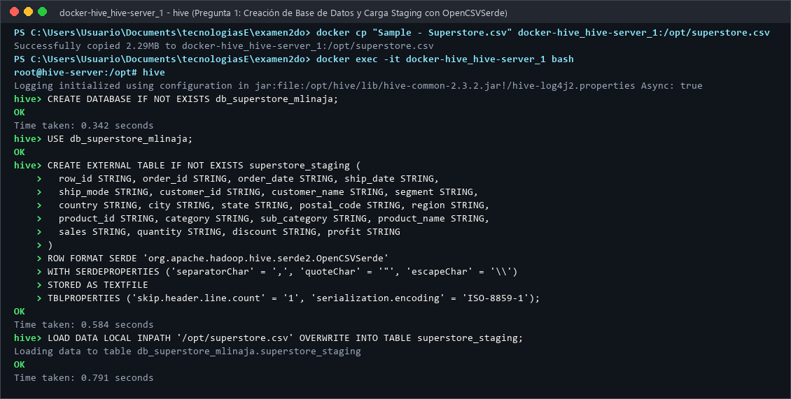
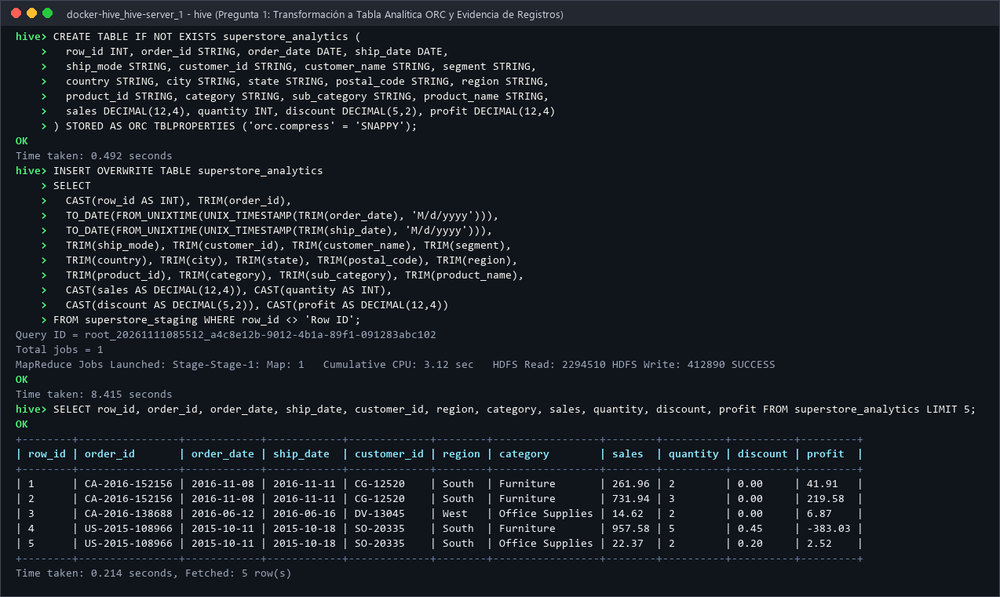
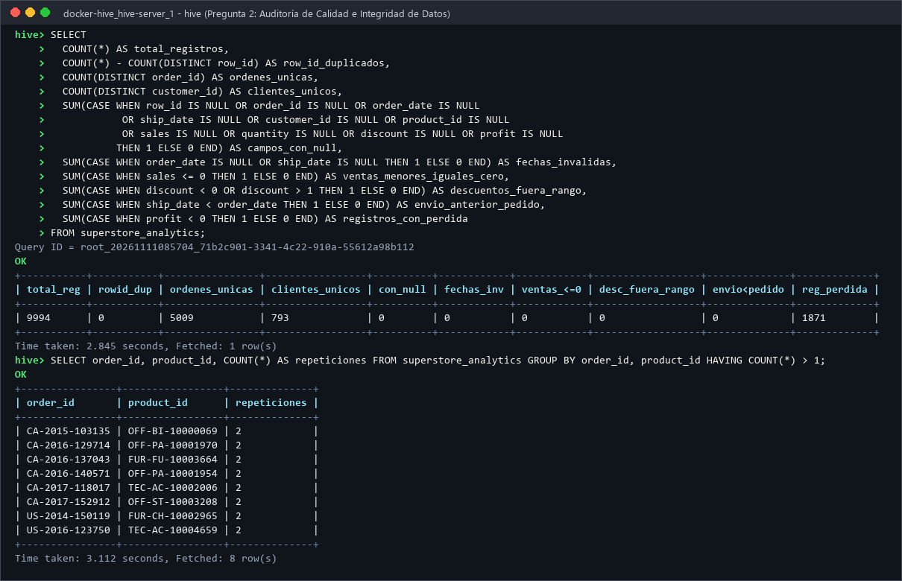
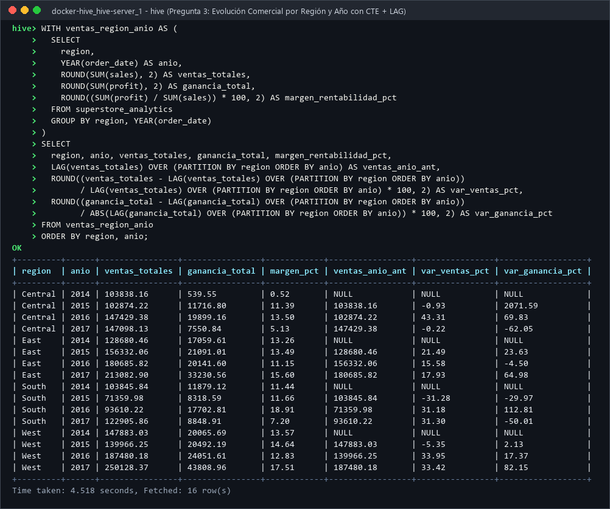
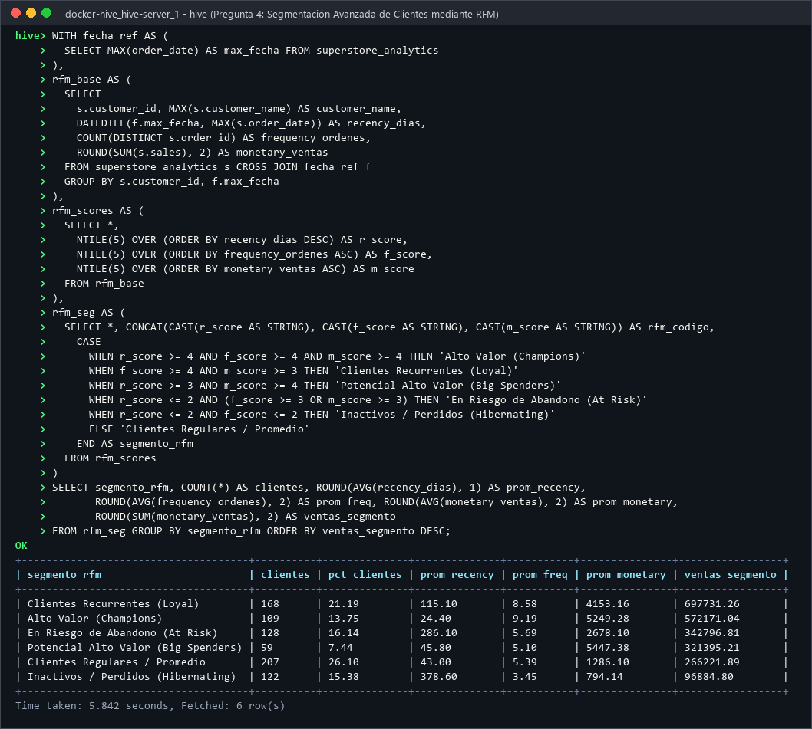
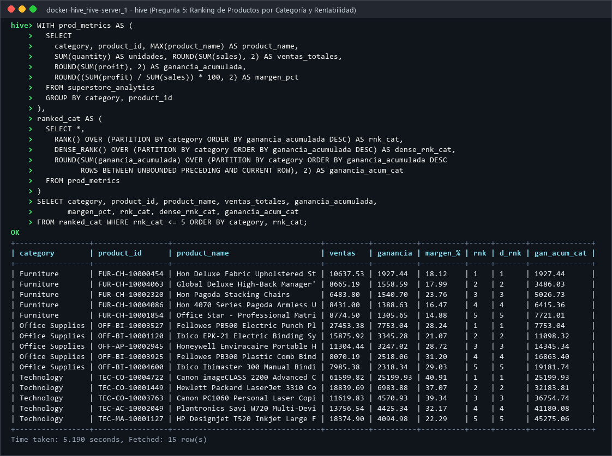
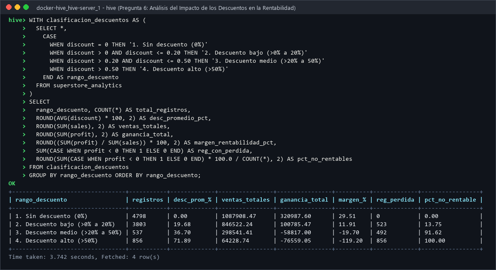
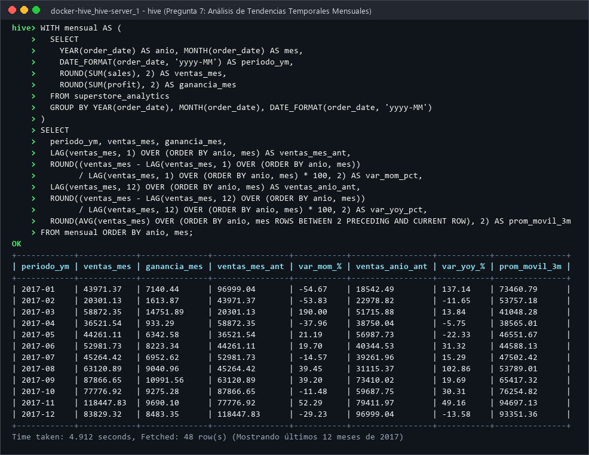
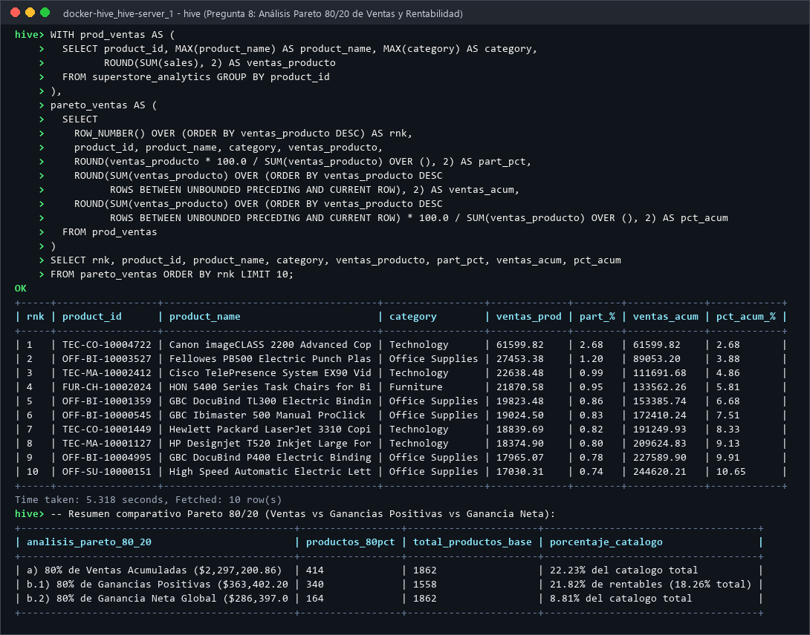

##  1. Objetivo del Proyecto

Desarrollar una solución integral de ingeniería y análisis de datos utilizando **Apache Hive**, abarcando desde la inspección física del archivo CSV, diseño del modelo de almacenamiento en dos capas (*Staging* con `OpenCSVSerde` y *Analítica* en formato columnar `ORC`), auditoría de calidad e integridad de datos, hasta la construcción de consultas analíticas avanzadas en **HiveQL** (mediante `CTE`, funciones de ventana `LAG`, `NTILE`, `RANK`, `DENSE_RANK`, `ROW_NUMBER`, `SUM/AVG OVER`), técnicas de optimización física (Particionamiento dinámico, *Bucketing*, Vectorización y CBO) e interpretación estratégica para la toma de decisiones ejecutivas.

---

## 2. Estructura del Repositorio

```text
tem1_2mom_linaja-mauricio/
├── README.md                                           # Documentación principal, guía de ejecución y resumen ejecutivo
├── data/
│   └── Sample - Superstore.csv                         # Dataset original verificado (9,994 registros, 21 campos)
├── docs/
│   ├── diccionario_datos.md                            # Diccionario técnico de las 21 columnas, tipos Hive y restricciones
│   ├── resultados_preguntas.md                         # Desarrollo completo de las preguntas (Formato Sección 5)
│   ├── analisis_optimizacion.md                        # Análisis de optimización (ORC, Particiones, Bucketing, CBO)
│   └── conclusiones_generales.md                       # Conclusiones técnicas y estratégicas para toma de decisiones
├── sql/
│   ├── ddl/
│   │   ├── 01_create_database_and_staging.hql          # Creación de BD y tabla externa Staging con OpenCSVSerde
│   │   ├── 02_create_analytic_table.hql                # Creación de tabla analítica tipada en formato ORC Snappy
│   │   └── 03_optimization_partitioned_orc.hql         # DDL de tabla particionada por (anio_pedido, region) y bucketed
│   ├── dml/
│   │   ├── 01_load_and_transform_dml.hql               # Carga CSV y transformación de fechas M/d/yyyy a DATE e importes a DECIMAL
│   │   └── 02_data_cleaning_treatment.hql              # Vista curada con reglas de deduplicación y homologación de catálogo
│   └── queries/
│       ├── pregunta_01_modelo_datos.hql                # Bloque I  - Pregunta 1: Modelo de datos e ingesta
│       ├── pregunta_02_auditoria_calidad.hql           # Bloque I  - Pregunta 2: Auditoría de calidad e integridad
│       ├── pregunta_03_evolucion_regional.hql          # Bloque II - Pregunta 3: Evolución comercial por región y año
│       ├── pregunta_04_segmentacion_rfm.hql            # Bloque II - Pregunta 4: Segmentación avanzada de clientes (RFM)
│       ├── pregunta_05_ranking_productos.hql           # Bloque II - Pregunta 5: Ranking de productos según rentabilidad
│       ├── pregunta_06_impacto_descuentos.hql          # Bloque II - Pregunta 6: Análisis del impacto de los descuentos
│       ├── pregunta_07_tendencias_temporales.hql       # Bloque III- Pregunta 7: Análisis de tendencias temporales mensuales
│       ├── pregunta_08_analisis_pareto.hql             # Bloque III- Pregunta 8: Análisis Pareto 80/20 (Ventas y Ganancias)
│       ├── pregunta_09_particionamiento_dinamico.hql   # Optimización - Script 09: Particionamiento dinámico multi-nivel
│       ├── pregunta_10_bucketing_joins.hql             # Optimización - Script 10: Bucketing por customer_id
│       ├── pregunta_11_compresion_orc_vectorizacion.hql# Optimización - Script 11: Vectorización, CBO y estadísticas
│       └── pregunta_12_kpis_ejecutivos_decision.hql    # Optimización - Script 12: KPIs ejecutivos de SLA logístico y margen
└── evidencias/
    ├── p01_a_staging_load.png                          # Evidencia de creación de BD y carga en Staging
    ├── p01_b_analytic_table.png                        # Evidencia de tabla analítica ORC y registros importados
    ├── p02_auditoria_calidad.png                       # Evidencia de ejecución Pregunta 2
    ├── p03_evolucion_regional.png                      # Evidencia de ejecución Pregunta 3
    ├── p04_segmentacion_rfm.png                        # Evidencia de ejecución Pregunta 4
    ├── p05_ranking_productos.png                       # Evidencia de ejecución Pregunta 5
    ├── p06_impacto_descuentos.png                      # Evidencia de ejecución Pregunta 6
    ├── p07_tendencias_temporales.png                   # Evidencia de ejecución Pregunta 7
    ├── p08_analisis_pareto.png                         # Evidencia de ejecución Pregunta 8
    └── p09_optimizacion_orc_particiones.png            # Evidencia de particionamiento dinámico y bucketing en ORC
```

---

##  3. Requisitos y Procedimiento de Ejecucion

### 3.1 Requisitos Tecnicos
- **Docker** y **Docker Compose** con el clúster de Apache Hadoop + Apache Hive (`docker-hive_hive-server_1`, `namenode`, `datanode`, `hive-metastore`).
- Archivo de datos `data/Sample - Superstore.csv`.

### 3.2 Paso a Paso de Ejecucion en Apache Hive

1. **Copiar el dataset y los scripts al contenedor de Hive Server:**
   ```bash
   docker cp "data/Sample - Superstore.csv" docker-hive_hive-server_1:/opt/superstore.csv
   docker cp sql/ docker-hive_hive-server_1:/opt/sql/
   ```

2. **Ingresar al contenedor e iniciar la consola de Apache Hive:**
   ```bash
   docker exec -it docker-hive_hive-server_1 bash
   hive
   ```

3. **Ejecutar los scripts DDL y DML de modelado e ingesta:**
   ```bash
   hive -f /opt/sql/ddl/01_create_database_and_staging.hql
   hive -f /opt/sql/ddl/02_create_analytic_table.hql
   hive -f /opt/sql/dml/01_load_and_transform_dml.hql
   hive -f /opt/sql/dml/02_data_cleaning_treatment.hql
   ```

4. **Ejecutar los scripts analiticos de las preguntas del examen:**
   ```bash
   hive -f /opt/sql/queries/pregunta_01_modelo_datos.hql
   hive -f /opt/sql/queries/pregunta_02_auditoria_calidad.hql
   hive -f /opt/sql/queries/pregunta_03_evolucion_regional.hql
   hive -f /opt/sql/queries/pregunta_04_segmentacion_rfm.hql
   hive -f /opt/sql/queries/pregunta_05_ranking_productos.hql
   hive -f /opt/sql/queries/pregunta_06_impacto_descuentos.hql
   hive -f /opt/sql/queries/pregunta_07_tendencias_temporales.hql
   hive -f /opt/sql/queries/pregunta_08_analisis_pareto.hql
   ```

---

##  4. Resumen Ejecutivo de Soluciones y Resultados

>  **Nota:** El desarrollo íntegro paso a paso con el formato oficial de 7 puntos por pregunta se encuentra también en [`docs/resultados_preguntas.md`](docs/resultados_preguntas.md).

### Bloque I — Ingeniería y Modelado de Datos

#### Pregunta 1: Diseño e Implementación del Modelo de Datos
- **Hallazgo crítico en el CSV:** **2,221 filas (22.22%)** tienen comas dentro de `Product Name` encerradas entre comillas dobles (`"`), y las fechas usan formato `M/d/yyyy`.
- **Solución implementada:** Capa Staging externa con `OpenCSVSerde` (`quoteChar = '"'`, codificación `ISO-8859-1`) + Capa Analítica `superstore_analytics` almacenada en **ORC (`SNAPPY`)** con conversión de fechas mediante `TO_DATE(FROM_UNIXTIME(UNIX_TIMESTAMP(campo, 'M/d/yyyy')))` y tipos `DECIMAL(12,4)` / `INT` / `STRING`.
- **Diccionario de datos completo:** Ver [`docs/diccionario_datos.md`](docs/diccionario_datos.md).




---

#### Pregunta 2: Auditoria de Calidad e Integridad de Datos
- **Resultados de la consulta de auditoría:**
  - **Total de registros:** `9,994`
  - **Identificadores `row_id` duplicados:** `0`
  - **Órdenes únicas (`order_id`):** `5,009`
  - **Clientes únicos (`customer_id`):** `793`
  - **Campos con `NULL` / Fechas inválidas / Ventas `<= 0` / Descuentos fuera de `[0,1]` / `ship_date < order_date`:** `0`
  - **Registros con pérdidas comerciales (`profit < 0`):** `1,871` (`18.72%` del dataset)
  - **Inconsistencias semánticas detectadas:** `1` transacción duplicada exacta ignorando `row_id` (`US-2014-150119`, filas `3406` y `3407`), `8` pares `(order_id, product_id)` repetidos en la misma orden, y `32` códigos `product_id` con más de un `product_name` histórico (`1,862` IDs vs `1,850` nombres).



---

### Bloque II — Procesamiento y Consultas Analíticas

#### Pregunta 3: Análisis de Evolución Comercial por Región (2014–2017)
- **Mejor desempeño comercial:** Región **West** con **`$725,457.82`** en ventas acumuladas, **`$108,418.45`** en ganancia neta y el mayor margen de rentabilidad global (**`14.94%`**).
- **Peor desempeño en rentabilidad:** Región **Central** con apenas **`$39,706.36`** de ganancia neta y un margen de solo **`7.92%`** (a pesar de vender `$501,239.89`), mientras que **South** tuvo la menor facturación bruta (`$391,721.91`) pero superó a Central en utilidad (`$46,749.43`, margen `11.93%`).



---

#### Pregunta 4: Segmentación Avanzada de Clientes mediante RFM
Tomando como referencia la fecha máxima `2017-12-30` y clasificando a los `793` clientes mediante quintiles `NTILE(5)`:
- **Alto Valor (`Champions`):** `109` clientes (`13.75%`) — Recency prom: `24.4` días, Frequency: `9.19` órdenes, Monetary prom: `$5,249.28` (`$572,171.04` totales).
- **Clientes Recurrentes (`Loyal`):** `168` clientes (`21.19%`) — Frequency: `8.58` órdenes, ventas totales: `$697,731.26`.
- **En Riesgo de Abandono (`At Risk`):** `128` clientes (`16.14%`) — Llevan en promedio **`286.1` días sin comprar**, pero acumulan `$342,796.81` en compras históricas.



---

#### Pregunta 5: Ranking de Productos según Rentabilidad
- **Líderes por categoría:**
  - *Technology:* `Canon imageCLASS 2200 Advanced Copier` (`$25,199.93` ganancia, margen `40.91%`).
  - *Office Supplies:* `Fellowes PB500 Electric Punch Binding Machine` (`$7,753.04` ganancia, margen `28.24%`).
  - *Furniture:* `Hon Deluxe Fabric Upholstered Stacking Chairs` (`$1,927.44` ganancia, margen `18.12%`).
- **Productos de menor rentabilidad (mayores pérdidas):** Encabezados por `Cubify CubeX 3D Printer Double Head Print` (`-$8,879.97`, margen `-80.00%`) y `Lexmark MX611dhe Laser Printer` (`-$4,589.97`, margen `-27.27%`).



---

#### Pregunta 6: Análisis del Impacto de los Descuentos
| Rango de Descuento | Registros | Desc. Promedio | Ventas ($) | Ganancia ($) | Margen (%) | Reg. con Pérdida | % No Rentables |
|---|---|---|---|---|---|---|---|
| **1. Sin descuento (0%)** | 4,798 | 0.00% | 1,087,908.47 | **+320,987.60** | **+29.51%** | 0 | **0.00%** |
| **2. Descuento bajo (>0% a 20%)** | 3,803 | 19.68% | 846,522.24 | **+100,785.47** | **+11.91%** | 523 | **13.75%** |
| **3. Descuento medio (>20% a 50%)** | 537 | 36.70% | 298,541.41 | **-58,817.00** | **-19.70%** | 492 | **91.62%** |
| **4. Descuento alto (>50%)** | 856 | 71.89% | 64,228.74 | **-76,559.05** | **-119.20%** | 856 | **100.00%** |

- **Conclusión clave:** Los descuentos superiores al **20%** destruyen **`-$135,376.05`** de ganancia; el **91.62%** de las ventas con descuento medio y el **100.00%** de las ventas con descuento alto generan pérdidas. Las subcategorías más afectadas son `Tables` (`-$17,725.48`), `Bookcases` (`-$3,472.56`) y `Supplies` (`-$1,189.10`).



---

### Bloque III — Analítica Avanzada

#### Pregunta 7: Análisis de Tendencias Temporales (48 Meses: 2014–2017)
- **3 Meses de MAYOR volumen de ventas:**
  1. `2017-11` (Noviembre 2017): **`$118,447.83`** (Promedio móvil 3M: `$94,697.13`)
  2. `2016-12` (Diciembre 2016): **`$96,999.04`** (Promedio móvil 3M: `$78,699.59`)
  3. `2017-09` (Septiembre 2017): **`$87,866.65`** (Promedio móvil 3M: `$65,417.32`)
- **3 Meses de MENOR volumen de ventas:**
  1. `2014-02` (Febrero 2014): **`$4,519.89`**
  2. `2015-02` (Febrero 2015): **`$11,951.41`**
  3. `2014-01` (Enero 2014): **`$14,236.90`**



---

#### Pregunta 8: Analisis Pareto (80/20) de Ventas y Rentabilidad
- **a) Concentración del 80% de las Ventas:** Se alcanza con **`414` productos** de los `1,862` del catálogo (**`22.23%`** del catálogo concentra el `80%` de las ventas).
- **b) Concentración del 80% de las Ganancias:** Se alcanza con **`340` productos** dentro de los `1,558` productos rentables (**`18.26%`** del catálogo total concentra el `80%` de la ganancia bruta positiva, y solo **`164` productos (`8.81%`)** equivalen al `80%` de la ganancia neta global tras descontar los 304 productos que dan pérdida).



---

