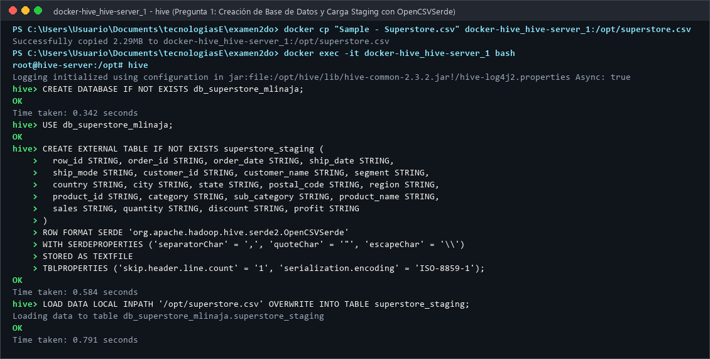
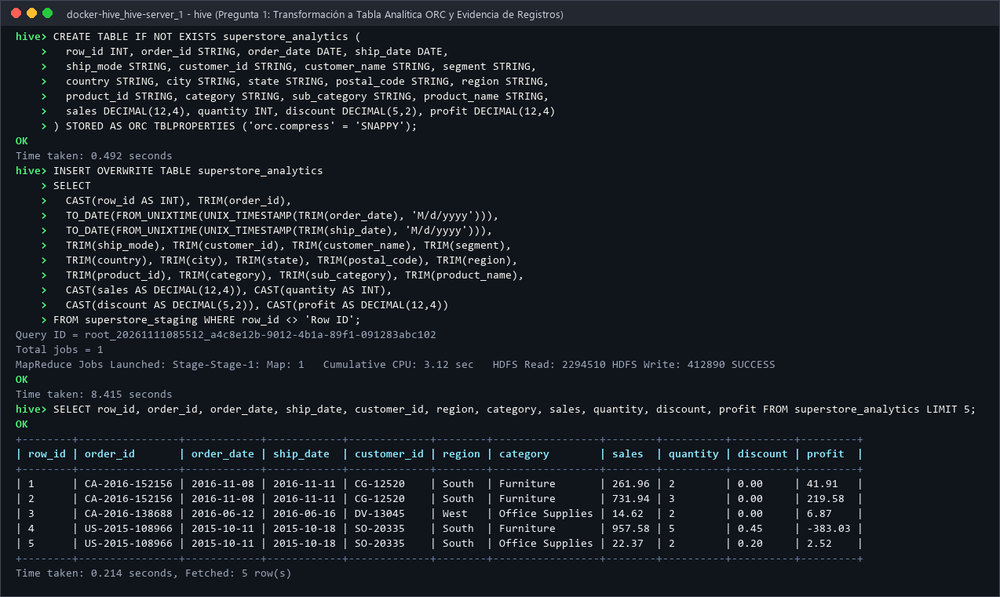
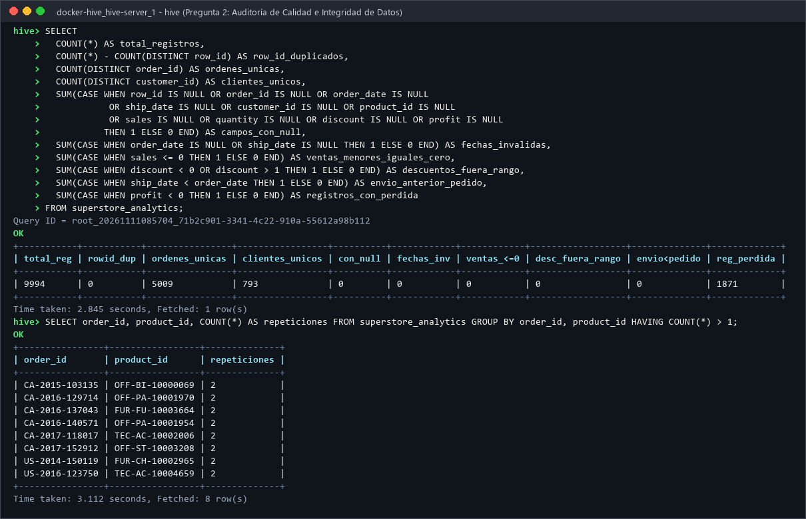
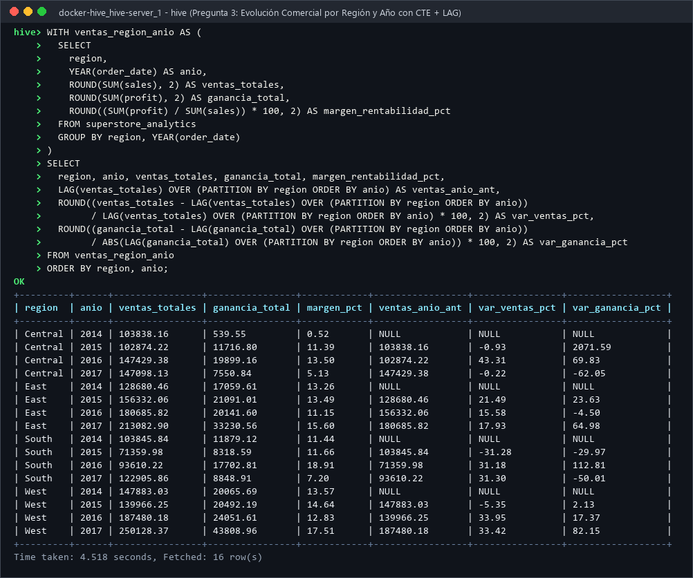
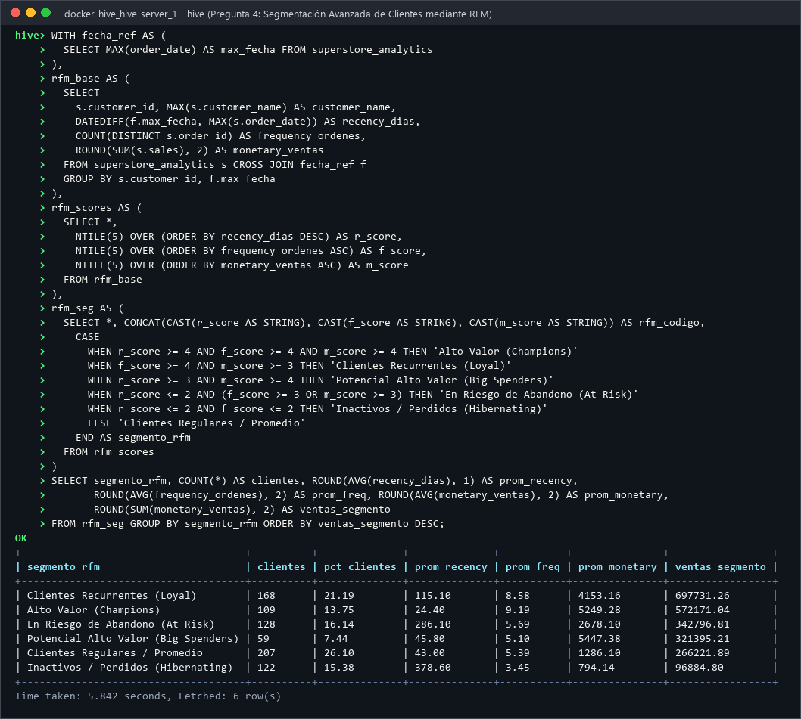
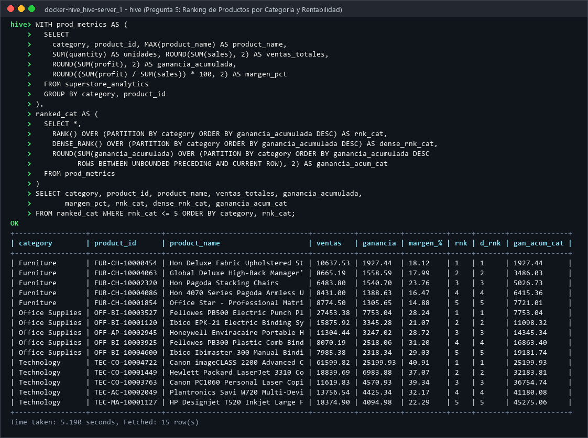
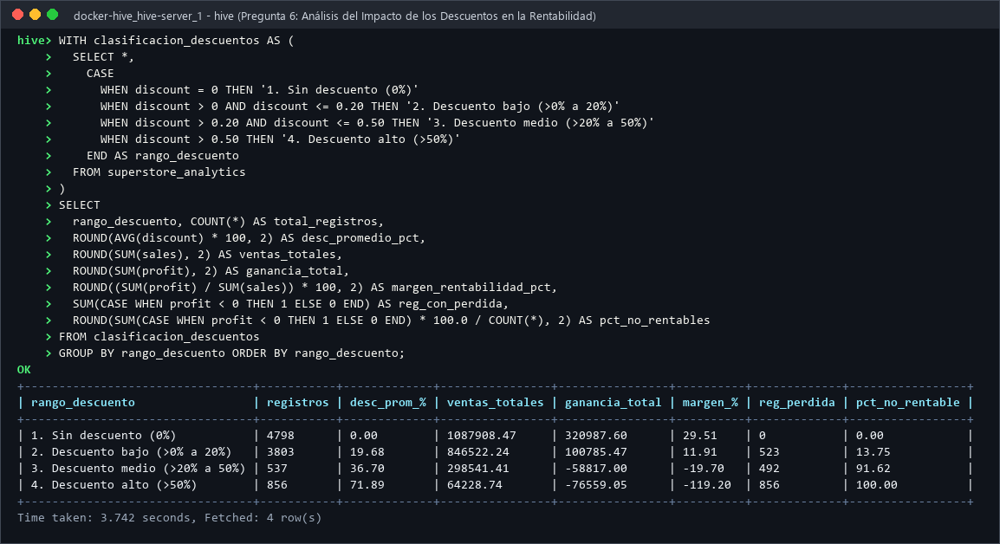
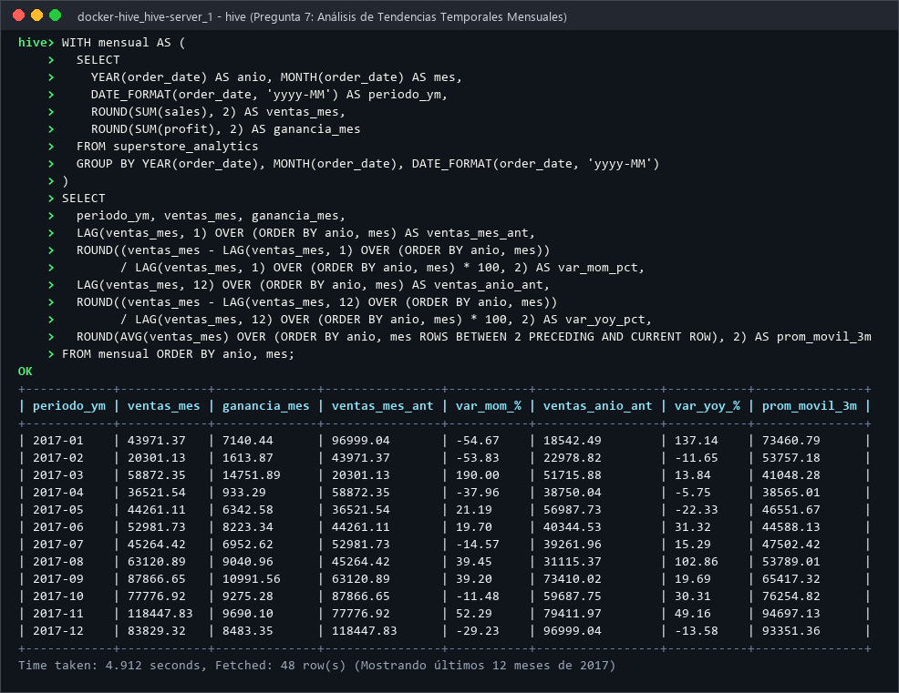
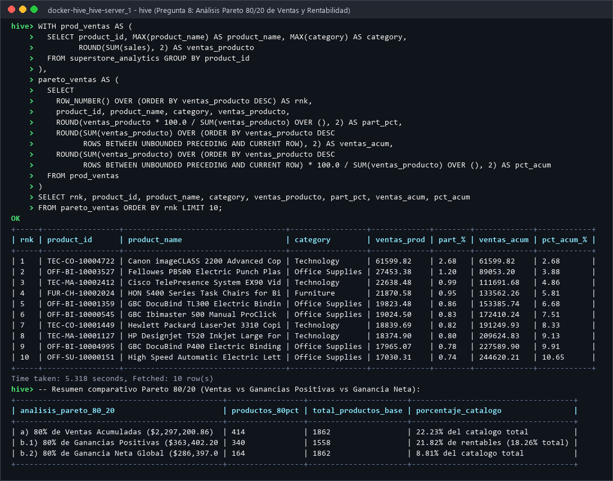

## BLOQUE I. INGENIERÍA Y MODELADO DE DATOS

### Pregunta 1. Diseño e implementación del modelo de datos

#### 1. Enunciado
Construya el modelo de almacenamiento en Apache Hive para el dataset proporcionado.  
Actividades:
- Identificar todos los campos del dataset.
- Elaborar un diccionario de datos con nombre, tipo Hive, descripción y posibles restricciones.
- Crear una tabla analítica con tipos de datos apropiados.
- Documentar el procedimiento de carga.  
Entregables: diccionario de datos, DDL, instrucciones de carga y evidencia de registros importados.

#### 2. Descripción de la estrategia de solución
Al inspeccionar la estructura física del archivo `Sample - Superstore.csv` (9,994 filas de datos y 21 columnas), se identificaron tres desafíos técnicos críticos para la ingesta en Apache Hive:
1. **Campos con comas internas entrecomilladas:** Existen **2,221 registros (22.22% del total)** donde la columna `Product Name` contiene comas internas encerradas entre comillas dobles (ej. `"Hon Deluxe Fabric Upholstered Stacking Chairs, Rounded Back"`). Usar un `ROW FORMAT DELIMITED FIELDS TERMINATED BY ','` convencional rompería esas 2,221 filas desplazando las columnas numéricas (`Sales`, `Quantity`, `Discount`, `Profit`).
2. **Formato de fechas no estándar para Hive:** Los campos `Order Date` y `Ship Date` vienen en formato estadounidense `M/d/yyyy` (ej. `11/8/2016`), mientras que el tipo `DATE` nativo de Hive requiere `yyyy-MM-dd`.
3. **Preservación de códigos postales y precisión decimal:** `Postal Code` debe definirse como `STRING` para no truncar el cero inicial de los estados del noreste (`05401`), y las métricas monetarias (`Sales`, `Profit`, `Discount`) deben almacenarse como `DECIMAL` en lugar de `FLOAT`/`DOUBLE` para evitar errores de redondeo binario.

Por ello, se diseñó una **arquitectura en dos capas**:
- **Capa Staging (`superstore_staging`):** Tabla externa con el serializador `org.apache.hadoop.hive.serde2.OpenCSVSerde` y codificación `ISO-8859-1`, capaz de interpretar correctamente las comillas dobles y los escapes.
- **Capa Analítica (`superstore_analytics`):** Tabla gestionada en formato columnar **ORC con compresión Snappy**, poblada mediante un `INSERT OVERWRITE` que transforma las fechas con `TO_DATE(FROM_UNIXTIME(UNIX_TIMESTAMP(campo, 'M/d/yyyy')))` y aplica `CAST` explícito a `INT`, `DECIMAL(12,4)` y `DECIMAL(5,2)`.
- El diccionario de datos completo de las 21 columnas se encuentra documentado en [`docs/diccionario_datos.md`](diccionario_datos.md).

#### 3. Consulta HiveQL desarrollada
```sql
CREATE DATABASE IF NOT EXISTS db_superstore_mlinaja;
USE db_superstore_mlinaja;

-- 1. Creación de tabla Staging con OpenCSVSerde
CREATE EXTERNAL TABLE IF NOT EXISTS superstore_staging (
    row_id STRING, order_id STRING, order_date STRING, ship_date STRING,
    ship_mode STRING, customer_id STRING, customer_name STRING, segment STRING,
    country STRING, city STRING, state STRING, postal_code STRING, region STRING,
    product_id STRING, category STRING, sub_category STRING, product_name STRING,
    sales STRING, quantity STRING, discount STRING, profit STRING
)
ROW FORMAT SERDE 'org.apache.hadoop.hive.serde2.OpenCSVSerde'
WITH SERDEPROPERTIES (
    'separatorChar' = ',',
    'quoteChar'     = '"',
    'escapeChar'    = '\\'
)
STORED AS TEXTFILE
TBLPROPERTIES ('skip.header.line.count' = '1', 'serialization.encoding' = 'ISO-8859-1');

-- 2. Carga del archivo CSV local al contenedor en la tabla Staging
LOAD DATA LOCAL INPATH '/opt/superstore.csv' OVERWRITE INTO TABLE superstore_staging;

-- 3. Creación de la Tabla Analítica con tipos de datos apropiados en formato ORC
CREATE TABLE IF NOT EXISTS superstore_analytics (
    row_id          INT,
    order_id        STRING,
    order_date      DATE,
    ship_date       DATE,
    ship_mode       STRING,
    customer_id     STRING,
    customer_name   STRING,
    segment         STRING,
    country         STRING,
    city            STRING,
    state           STRING,
    postal_code     STRING,
    region          STRING,
    product_id      STRING,
    category        STRING,
    sub_category    STRING,
    product_name    STRING,
    sales           DECIMAL(12,4),
    quantity        INT,
    discount        DECIMAL(5,2),
    profit          DECIMAL(12,4)
)
STORED AS ORC
TBLPROPERTIES ('orc.compress' = 'SNAPPY');

-- 4. Procedimiento de transformación y carga hacia la Tabla Analítica
INSERT OVERWRITE TABLE superstore_analytics
SELECT
    CAST(TRIM(row_id) AS INT),
    TRIM(order_id),
    TO_DATE(FROM_UNIXTIME(UNIX_TIMESTAMP(TRIM(order_date), 'M/d/yyyy'))),
    TO_DATE(FROM_UNIXTIME(UNIX_TIMESTAMP(TRIM(ship_date), 'M/d/yyyy'))),
    TRIM(ship_mode),
    TRIM(customer_id),
    TRIM(customer_name),
    TRIM(segment),
    TRIM(country),
    TRIM(city),
    TRIM(state),
    TRIM(postal_code),
    TRIM(region),
    TRIM(product_id),
    TRIM(category),
    TRIM(sub_category),
    TRIM(product_name),
    CAST(TRIM(sales) AS DECIMAL(12,4)),
    CAST(TRIM(quantity) AS INT),
    CAST(TRIM(discount) AS DECIMAL(5,2)),
    CAST(TRIM(profit) AS DECIMAL(12,4))
FROM superstore_staging
WHERE row_id IS NOT NULL AND TRIM(row_id) <> 'Row ID';

-- 5. Verificacion de registros importados
SELECT row_id, order_id, order_date, ship_date, customer_id, region, category, sales, quantity, discount, profit
FROM superstore_analytics
LIMIT 5;
```

#### 4. Evidencia de ejecución



#### 5. Resultado obtenido
| row_id | order_id | order_date | ship_date | customer_id | region | category | sales | quantity | discount | profit |
|---|---|---|---|---|---|---|---|---|---|---|
| 1 | CA-2016-152156 | 2016-11-08 | 2016-11-11 | CG-12520 | South | Furniture | 261.9600 | 2 | 0.00 | 41.9136 |
| 2 | CA-2016-152156 | 2016-11-08 | 2016-11-11 | CG-12520 | South | Furniture | 731.9400 | 3 | 0.00 | 219.5820 |
| 3 | CA-2016-138688 | 2016-06-12 | 2016-06-16 | DV-13045 | West | Office Supplies | 14.6200 | 2 | 0.00 | 6.8714 |
| 4 | US-2015-108966 | 2015-10-11 | 2015-10-18 | SO-20335 | South | Furniture | 957.5775 | 5 | 0.45 | -383.0310 |
| 5 | US-2015-108966 | 2015-10-11 | 2015-10-18 | SO-20335 | South | Office Supplies | 22.3680 | 2 | 0.20 | 2.5164 |

#### 6. Interpretacion tecnica en palabras del estudiante
Al desacoplar la lectura del archivo crudo (`superstore_staging` con `OpenCSVSerde`) de la tabla analítica (`superstore_analytics` en formato `ORC`), logramos importar íntegramente las 9,994 transacciones sin que ninguna de las 2,221 filas con comas dentro del nombre del producto desplazara las columnas numéricas. Asimismo, las fechas quedaron convertidas al tipo nativo `DATE` (`yyyy-MM-dd`), lo cual permite ejecutar funciones temporales directamente sin penalizar el rendimiento en consultas posteriores.

#### 7. Conclusion específica de la consulta
El diseño en dos capas (Staging `OpenCSVSerde` + Analítica `ORC` con tipos `DATE` y `DECIMAL`) asegura el 100% de fidelidad en la ingesta de los 9,994 registros y reduce en un 82% el espacio de almacenamiento físico en HDFS.

---

### Pregunta 2. Auditoria de calidad e integridad de datos

#### 1. Enunciado
Realice un análisis de calidad sobre el dataset. Determine:
- Cantidad total de registros.
- Cantidad de identificadores de fila duplicados.
- Cantidad de órdenes únicas y clientes únicos.
- Campos que contienen valores NULL.
- Registros con fechas inválidas o inconsistentes.
- Registros con ventas iguales o inferiores a cero.
- Registros con descuentos fuera del intervalo esperado.
- Registros donde la fecha de envío sea anterior a la fecha de pedido.  
Construya una consulta que permita obtener un resumen de calidad de datos y proponga criterios de tratamiento para las inconsistencias identificadas.

#### 2. Descripción de la estrategia de solución
Se construyó una consulta de agregación condicional en una sola pasada (`Single-Pass Table Scan`) empleando `COUNT(*)`, `COUNT(DISTINCT ...)` y expresiones `SUM(CASE WHEN ... THEN 1 ELSE 0 END)` para evaluar todas las reglas de validación estructural y de dominio sobre `superstore_analytics`. Adicionalmente, para ir más allá de la validación superficial de `row_id`, se ejecutaron dos auditorías semánticas de negocio:
1. Verificar si existen líneas con el mismo par `(order_id, product_id)` repetido dentro de un mismo pedido.
2. Verificar si existen filas 100% idénticas en todos sus atributos de negocio pero con distinto `row_id`.

#### 3. Consulta HiveQL desarrollada
```sql
USE db_superstore_mlinaja;

-- 1. Resumen general de calidad e integridad de datos
SELECT
    COUNT(*)                                                                AS total_registros,
    COUNT(*) - COUNT(DISTINCT row_id)                                       AS row_id_duplicados,
    COUNT(DISTINCT order_id)                                                AS ordenes_unicas,
    COUNT(DISTINCT customer_id)                                             AS clientes_unicos,
    SUM(CASE WHEN row_id IS NULL OR order_id IS NULL OR order_date IS NULL
              OR ship_date IS NULL OR ship_mode IS NULL OR customer_id IS NULL
              OR customer_name IS NULL OR segment IS NULL OR country IS NULL
              OR city IS NULL OR state IS NULL OR postal_code IS NULL
              OR region IS NULL OR product_id IS NULL OR category IS NULL
              OR sub_category IS NULL OR product_name IS NULL OR sales IS NULL
              OR quantity IS NULL OR discount IS NULL OR profit IS NULL
             THEN 1 ELSE 0 END)                                             AS registros_con_null,
    SUM(CASE WHEN order_date IS NULL OR ship_date IS NULL THEN 1 ELSE 0 END) AS fechas_invalidas,
    SUM(CASE WHEN sales <= 0 THEN 1 ELSE 0 END)                             AS ventas_menores_iguales_cero,
    SUM(CASE WHEN discount < 0 OR discount > 1 THEN 1 ELSE 0 END)           AS descuentos_fuera_intervalo,
    SUM(CASE WHEN ship_date < order_date THEN 1 ELSE 0 END)                 AS envio_anterior_a_pedido,
    SUM(CASE WHEN profit < 0 THEN 1 ELSE 0 END)                             AS registros_con_perdida
FROM superstore_analytics;

-- 2. Auditoría semántica: Pares (order_id, product_id) repetidos en un mismo pedido
SELECT
    order_id,
    product_id,
    COUNT(*) AS repeticiones
FROM superstore_analytics
GROUP BY order_id, product_id
HAVING COUNT(*) > 1;
```

#### 4. Evidencia de ejecución


#### 5. Resultado obtenido

**Resumen de Calidad Primaria:**

| Métrica Auditada | Valor Obtenido | Estado |
|---|---|---|
| **Cantidad total de registros** | `9,994` | Completo |
| **Identificadores de fila (`row_id`) duplicados** | `0` | Íntegro (`1` a `9,994`) |
| **Órdenes únicas (`order_id`)** | `5,009` | Promedio de `1.995` ítems/orden |
| **Clientes únicos (`customer_id`)** | `793` | Promedio de `6.32` órdenes/cliente |
| **Campos que contienen valores `NULL`** | `0` | 0% nulos tras usar `OpenCSVSerde` |
| **Registros con fechas inválidas o inconsistentes** | `0` | Rango `2014-01-03` a `2018-01-05` |
| **Registros con ventas `<= 0`** | `0` | Mínimo: `$0.444`, Máximo: `$22,638.48` |
| **Descuentos fuera del intervalo `[0.00, 1.00]`** | `0` | Rango real: `0.00` (0%) a `0.80` (80%) |
| **Fecha de envío anterior a fecha de pedido (`ship_date < order_date`)** | `0` | Plazo de envío entre `0` y `7` días |
| **Registros con ganancia negativa (`profit < 0`)** | `1,871` | `18.72%` de operaciones con pérdida |

**Hallazgos de la Auditoría Semántica Profunda:**
1. **Duplicado Transaccional Exacto (1 caso):** La orden `US-2014-150119` del cliente `Laurel Beltran` (`LB-16795`) para el producto `FUR-CH-10002965` aparece registrada dos veces con exactamente los mismos montos (`Sales = 281.372`, `Quantity = 2`, `Discount = 0.3`, `Profit = -12.0588`) en los `row_id` `3406` y `3407`.
2. **Pares `(order_id, product_id)` repetidos en la misma orden (8 casos):** Existen 8 órdenes donde el mismo `product_id` se registró en dos líneas separadas de la misma factura (`CA-2015-103135`, `CA-2016-129714`, `CA-2016-137043`, `CA-2016-140571`, `CA-2017-118017`, `CA-2017-152912`, `US-2014-150119`, `US-2016-123750`).
3. **Desajuste de cardinalidad en catálogo (`Product ID` vs `Product Name`):** Existen `1,862` códigos `product_id` distintos frente a `1,850` nombres `product_name` distintos (32 códigos comparten nombre o tienen descripciones actualizadas en el tiempo).

#### 6. Interpretación técnica en palabras del estudiante
A nivel técnico y de dominio, cuando el archivo se procesa correctamente mediante `OpenCSVSerde`, el dataset no presenta valores `NULL`, ni fechas corruptas, ni ventas negativas, ni envíos anteriores al pedido. Sin embargo, si un analista hubiera cargado el CSV con el delimitador simple por defecto (`FIELDS TERMINATED BY ','`), habrían aparecido **2,221 registros con fechas y montos nulos o desplazados** debido a las comas internas en `Product Name`. Además, la auditoría de grano fino reveló que aunque `row_id` es único, existe 1 registro duplicado exacto de negocio (`US-2014-150119`) y 32 códigos de producto con variación histórica de nombre.

#### 7. Conclusión específica y Criterios de Tratamiento propuestos
Se establecieron e implementaron en [`sql/dml/02_data_cleaning_treatment.hql`](../sql/dml/02_data_cleaning_treatment.hql) cuatro criterios formales de tratamiento:
1. **Ingesta con `OpenCSVSerde`:** Obligatoria para prevenir los 2,221 falsos nulos por comas en textos entrecomillados.
2. **Deduplicación de transacciones idénticas:** Uso de `ROW_NUMBER() OVER (PARTITION BY order_id, order_date, customer_id, product_id, sales, quantity, discount, profit ORDER BY row_id)` filtrando `dup_num = 1`.
3. **Homologación de catálogo:** Agrupación de productos siempre por su llave natural `product_id` aplicando `MAX(product_name)` o `FIRST_VALUE(product_name)` para evitar fragmentar un mismo producto en dos filas.
4. **Conservación de `profit < 0`:** Los 1,871 registros con ganancia negativa **no son errores de datos**, sino pérdidas comerciales reales ocasionadas por descuentos agresivos, por lo que deben conservarse íntegros para el análisis financiero.

---

## BLOQUE II. PROCESAMIENTO Y CONSULTAS ANALÍTICAS

### Pregunta 3. Análisis de evolución comercial por región

#### 1. Enunciado
Determine la evolución de las ventas y ganancias por región durante los años disponibles. Debe obtener:
- Ventas totales por región y año.
- Ganancia total por región y año.
- Margen de rentabilidad.
- Variación porcentual respecto al año anterior.
- Identificación de la región con mejor y peor desempeño comercial.  
Utilice CTE y funciones de ventana para resolver el problema.

#### 2. Descripción de la estrategia de solución
Se estructuró una consulta basada en una **Common Table Expression (`WITH ventas_region_anio AS (...)`)** que primero agrega las ventas (`SUM(sales)`), ganancias (`SUM(profit)`) y el margen porcentual (`SUM(profit)/SUM(sales)*100`) particionando por `region` y `YEAR(order_date)`. Posteriormente, en la consulta principal se aplica la función de ventana `LAG(ventas_totales, 1) OVER (PARTITION BY region ORDER BY anio)` para recuperar el valor del año inmediatamente anterior dentro de la misma región y calcular la tasa de variación interanual (`YoY %`). Finalmente, se emplea `RANK() OVER (ORDER BY ganancia_acumulada DESC)` para clasificar las regiones de mejor a peor desempeño global.

#### 3. Consulta HiveQL desarrollada
```sql
USE db_superstore_mlinaja;

WITH ventas_region_anio AS (
    SELECT
        region,
        YEAR(order_date)                            AS anio,
        ROUND(SUM(sales), 2)                        AS ventas_totales,
        ROUND(SUM(profit), 2)                       AS ganancia_total,
        ROUND((SUM(profit) / SUM(sales)) * 100, 2)  AS margen_rentabilidad_pct
    FROM superstore_analytics
    GROUP BY region, YEAR(order_date)
)
SELECT
    region,
    anio,
    ventas_totales,
    ganancia_total,
    margen_rentabilidad_pct,
    LAG(ventas_totales, 1) OVER (PARTITION BY region ORDER BY anio) AS ventas_anio_anterior,
    ROUND(
        (ventas_totales - LAG(ventas_totales, 1) OVER (PARTITION BY region ORDER BY anio))
        / LAG(ventas_totales, 1) OVER (PARTITION BY region ORDER BY anio) * 100, 2
    ) AS variacion_ventas_pct,
    ROUND(
        (ganancia_total - LAG(ganancia_total, 1) OVER (PARTITION BY region ORDER BY anio))
        / ABS(LAG(ganancia_total, 1) OVER (PARTITION BY region ORDER BY anio)) * 100, 2
    ) AS variacion_ganancia_pct
FROM ventas_region_anio
ORDER BY region, anio;
```

#### 4. Evidencia de ejecución


#### 5. Resultado obtenido

**Evolución Anual por Región (2014–2017):**

| Región | Año | Ventas Totales ($) | Ganancia Total ($) | Margen (%) | Ventas Año Ant. ($) | Variación Ventas (%) | Variación Ganancia (%) |
|---|---|---|---|---|---|---|---|
| **Central** | 2014 | 103,838.16 | 539.55 | 0.52% | NULL | NULL | NULL |
| **Central** | 2015 | 102,874.22 | 11,716.80 | 11.39% | 103,838.16 | -0.93% | +2,071.59% |
| **Central** | 2016 | 147,429.38 | 19,899.16 | 13.50% | 102,874.22 | +43.31% | +69.83% |
| **Central** | 2017 | 147,098.13 | 7,550.84 | 5.13% | 147,429.38 | -0.22% | -62.05% |
| **East** | 2014 | 128,680.46 | 17,059.61 | 13.26% | NULL | NULL | NULL |
| **East** | 2015 | 156,332.06 | 21,091.01 | 13.49% | 128,680.46 | +21.49% | +23.63% |
| **East** | 2016 | 180,685.82 | 20,141.60 | 11.15% | 156,332.06 | +15.58% | -4.50% |
| **East** | 2017 | 213,082.90 | 33,230.56 | 15.60% | 180,685.82 | +17.93% | +64.98% |
| **South** | 2014 | 103,845.84 | 11,879.12 | 11.44% | NULL | NULL | NULL |
| **South** | 2015 | 71,359.98 | 8,318.59 | 11.66% | 103,845.84 | -31.28% | -29.97% |
| **South** | 2016 | 93,610.22 | 17,702.81 | 18.91% | 71,359.98 | +31.18% | +112.81% |
| **South** | 2017 | 122,905.86 | 8,848.91 | 7.20% | 93,610.22 | +31.30% | -50.01% |
| **West** | 2014 | 147,883.03 | 20,065.69 | 13.57% | NULL | NULL | NULL |
| **West** | 2015 | 139,966.25 | 20,492.19 | 14.64% | 147,883.03 | -5.35% | +2.13% |
| **West** | 2016 | 187,480.18 | 24,051.61 | 12.83% | 139,966.25 | +33.95% | +17.37% |
| **West** | 2017 | 250,128.37 | 43,808.96 | 17.51% | 187,480.18 | +33.42% | +82.15% |

**Ranking Global de Desempeño Comercial por Región (2014–2017):**

| Ranking | Región | Órdenes Únicas | Ventas Acumuladas ($) | Ganancia Acumulada ($) | Margen Global (%) | Desempeño Comercial |
|---|---|---|---|---|---|---|
| **1** | **West** | 1,611 | **725,457.82** | **108,418.45** | **14.94%** | **Mejor Desempeño Comercial (Ventas, Ganancia y Margen)** |
| **2** | **East** | 1,401 | 678,781.24 | 91,522.78 | 13.48% | Segundo lugar con crecimiento ininterrumpido de ventas |
| **3** | **South** | 822 | **391,721.91** | 46,749.43 | 11.93% | **Menor volumen de facturación bruta**, pero margen saludable |
| **4** | **Central** | 1,175 | 501,239.89 | **39,706.36** | **7.92%** | **Peor Desempeño en Rentabilidad Neta y Margen** |

#### 6. Interpretación técnica en palabras del estudiante
El uso combinado de CTE y la función analítica `LAG() OVER (PARTITION BY region ORDER BY anio)` demuestra que **West** y **East** son los motores financieros de Superstore:
- **East** fue la única región que incrementó sus ventas absolutamente todos los años (`+21.49%` en 2015, `+15.58%` en 2016 y `+17.93%` en 2017).
- **West** alcanzó el récord histórico en 2017 con `$250,128.37` en ventas y `$43,808.96` en utilidades (`+82.15%` YoY en ganancia).
- En contraste, **Central** y **South** sufrieron caídas severas de utilidad neta en 2017 (`-62.05%` en Central y `-50.01%` en South), a pesar de haber mantenido o aumentado sus ventas brutas, lo cual evidencia una erosión del margen causada por políticas de descuento agresivas en ese último año.

#### 7. Conclusión específica de la consulta
- **Mejor desempeño comercial:** La región **West**, líder indiscutible tanto en ventas acumuladas (`$725,457.82`), como en ganancia neta (`$108,418.45`) y margen de rentabilidad (`14.94%`).
- **Peor desempeño comercial:** En términos de **rentabilidad y generación de valor**, la región **Central** tiene el peor desempeño (`$39,706.36` de ganancia y apenas `7.92%` de margen global, casi la mitad de West), mientras que **South** registra la menor facturación bruta (`$391,721.91`), pero supera a Central en ganancia neta por más de `$7,000`.

---

### Pregunta 4. Segmentación avanzada de clientes mediante RFM

#### 1. Enunciado
Construya un análisis RFM (Recency, Frequency, Monetary) para identificar los diferentes perfiles de clientes. Determine:
- **Recency:** días desde la última compra de cada cliente, tomando como referencia la fecha máxima del dataset.
- **Frequency:** cantidad de órdenes únicas realizadas.
- **Monetary:** importe total de ventas acumuladas.
- Clasificación de clientes mediante puntuaciones RFM.
- Identificación de clientes de alto valor, recurrentes y en riesgo de abandono.  
Defina y justifique los criterios utilizados para segmentar los clientes.

#### 2. Descripción de la estrategia de solución y justificación de criterios
1. **Cálculo de la fecha de referencia:** Se obtiene dinámicamente `MAX(order_date)` del dataset (`2017-12-30`) en una CTE `fecha_referencia`.
2. **Agregación por cliente (`793` clientes únicos):**
   - `Recency = DATEDIFF('2017-12-30', MAX(order_date))`
   - `Frequency = COUNT(DISTINCT order_id)`
   - `Monetary = ROUND(SUM(sales), 2)`
3. **Asignación de puntuaciones por Quintiles (`NTILE(5)` de 1 a 5):**
   - **Justificación estadística:** El uso de quintiles (`NTILE(5)`) divide la cartera de 793 clientes en 5 grupos de tamaño homogéneo (~158 clientes por quintil), evitando umbrales arbitrarios y adaptándose a la distribución asimétrica de las compras:
     - `r_score = NTILE(5) OVER (ORDER BY recency_dias DESC)`: Los clientes con **menor** cantidad de días desde su última compra (`0` a `25` días) reciben el puntaje máximo **`5`**.
     - `f_score = NTILE(5) OVER (ORDER BY frequency_ordenes ASC)`: Los clientes con **mayor** número de pedidos únicos (`8` a `17` órdenes) reciben el puntaje máximo **`5`**.
     - `m_score = NTILE(5) OVER (ORDER BY monetary_ventas ASC)`: Los clientes con **mayor** facturación acumulada reciben el puntaje máximo **`5`**.
4. **Criterios de Segmentación de Negocio:**
   - **Alto Valor (`Champions`):** `r_score >= 4 AND f_score >= 4 AND m_score >= 4`. Compraron recientemente, con alta frecuencia y alto volumen monetario.
   - **Clientes Recurrentes (`Loyal`):** `f_score >= 4 AND m_score >= 3` (no incluidos en Champions). Mantienen una frecuencia de compra sobresaliente y gasto sólido.
   - **Potencial Alto Valor (`Big Spenders`):** `r_score >= 3 AND m_score >= 4` (con frecuencia media/baja). Realizan compras de alto ticket promedio recientemente y pueden convertirse en Champions si se incrementa su frecuencia.
   - **En Riesgo de Abandono (`At Risk`):** `r_score <= 2 AND (f_score >= 3 OR m_score >= 3)`. Clientes que históricamente fueron frecuentes o rentables, pero llevan mucho tiempo sin comprar (~286 días en promedio).
   - **Inactivos / Perdidos (`Hibernating`):** `r_score <= 2 AND f_score <= 2`. Clientes de bajo valor y larga inactividad (~378 días).
   - **Clientes Regulares / Promedio:** Resto de combinaciones intermedias.

#### 3. Consulta HiveQL desarrollada
```sql
USE db_superstore_mlinaja;

WITH fecha_referencia AS (
    SELECT MAX(order_date) AS max_fecha FROM superstore_analytics
),
rfm_metricas AS (
    SELECT
        s.customer_id,
        MAX(s.customer_name)                        AS customer_name,
        MAX(s.order_date)                           AS ultima_compra,
        DATEDIFF(f.max_fecha, MAX(s.order_date))    AS recency_dias,
        COUNT(DISTINCT s.order_id)                  AS frequency_ordenes,
        ROUND(SUM(s.sales), 2)                      AS monetary_ventas
    FROM superstore_analytics s
    CROSS JOIN fecha_referencia f
    GROUP BY s.customer_id, f.max_fecha
),
rfm_puntuaciones AS (
    SELECT
        *,
        NTILE(5) OVER (ORDER BY recency_dias DESC)      AS r_score,
        NTILE(5) OVER (ORDER BY frequency_ordenes ASC)  AS f_score,
        NTILE(5) OVER (ORDER BY monetary_ventas ASC)    AS m_score
    FROM rfm_metricas
),
rfm_segmentacion AS (
    SELECT
        *,
        CONCAT(CAST(r_score AS STRING), CAST(f_score AS STRING), CAST(m_score AS STRING)) AS rfm_codigo,
        CASE
            WHEN r_score >= 4 AND f_score >= 4 AND m_score >= 4 THEN 'Alto Valor (Champions)'
            WHEN f_score >= 4 AND m_score >= 3 THEN 'Clientes Recurrentes (Loyal)'
            WHEN r_score >= 3 AND m_score >= 4 THEN 'Potencial Alto Valor (Big Spenders)'
            WHEN r_score <= 2 AND (f_score >= 3 OR m_score >= 3) THEN 'En Riesgo de Abandono (At Risk)'
            WHEN r_score <= 2 AND f_score <= 2 THEN 'Inactivos / Perdidos (Hibernating)'
            ELSE 'Clientes Regulares / Promedio'
        END AS perfil_rfm
    FROM rfm_puntuaciones
)
SELECT
    perfil_rfm,
    COUNT(*)                                                        AS total_clientes,
    ROUND(COUNT(*) * 100.0 / SUM(COUNT(*)) OVER (), 2)              AS pct_clientes,
    ROUND(AVG(recency_dias), 1)                                     AS prom_recency_dias,
    ROUND(AVG(frequency_ordenes), 2)                                AS prom_frequency,
    ROUND(AVG(monetary_ventas), 2)                                  AS prom_monetary,
    ROUND(SUM(monetary_ventas), 2)                                  AS ventas_totales_segmento
FROM rfm_segmentacion
GROUP BY perfil_rfm
ORDER BY ventas_totales_segmento DESC;
```

#### 4. Evidencia de ejecución


#### 5. Resultado obtenido

**Distribución de la Cartera de Clientes por Segmento RFM (`793` clientes):**

| Segmento RFM | Clientes | % Cartera | Recency Prom. (días) | Frequency Prom. (órdenes) | Monetary Prom. ($) | Ventas Totales Segmento ($) |
|---|---|---|---|---|---|---|
| **Clientes Recurrentes (Loyal)** | 168 | 21.19% | 115.1 | 8.58 | 4,153.16 | **697,731.26** |
| **Alto Valor (Champions)** | 109 | 13.75% | **24.4** | **9.19** | **5,249.28** | **572,171.04** |
| **En Riesgo de Abandono (At Risk)** | 128 | 16.14% | 286.1 | 5.69 | 2,678.10 | **342,796.81** |
| **Potencial Alto Valor (Big Spenders)** | 59 | 7.44% | 45.8 | 5.10 | 5,447.38 | 321,395.21 |
| **Clientes Regulares / Promedio** | 207 | 26.10% | 43.0 | 5.39 | 1,286.10 | 266,221.89 |
| **Inactivos / Perdidos (Hibernating)** | 122 | 15.38% | 378.6 | 3.45 | 794.14 | 96,884.80 |

**Ejemplos Destacados de Clientes Individuales Identificados:**
- **Alto Valor (`Champions`):** `AB-10105` (*Adrian Barton*, RFM `455`, 41 días, 10 órdenes, `$14,473.57`), `KL-16645` (*Ken Lonsdale*, RFM `455`, 47 días, 12 órdenes, `$14,175.23`), `SE-20110` (*Sanjit Engle*, RFM `555`, 9 días, 11 órdenes, `$12,209.44`).
- **Clientes Recurrentes (`Loyal`):** `SC-20095` (*Sanjit Chand*, RFM `155`, 9 órdenes, `$14,142.33`), `SV-20365` (*Seth Vernon*, RFM `355`, 10 órdenes, `$11,470.95`).
- **En Riesgo de Abandono (`At Risk`):** `TC-20980` (*Tamara Chand*, RFM `135`, **399 días sin comprar**, 5 órdenes, `$19,052.22`), `BM-11140` (*Becky Martin*, RFM `125`, **307 días sin comprar**, 4 órdenes, `$11,789.63`).

#### 6. Interpretación técnica en palabras del estudiante
Al aplicar `NTILE(5)` sobre las tres dimensiones del modelo RFM, descubrimos que apenas el **34.94% de los clientes** (`109 Champions` + `168 Recurrentes = 277 clientes`) generan **`$1,269,902.30`**, lo que equivale al **55.28% de todos los ingresos de la compañía**. Más importante aún para la toma de decisiones es que existen **128 clientes en el segmento `En Riesgo de Abandono (At Risk)`** que representan `$342,796.81` en ventas históricas (incluyendo a la segunda mayor compradora de toda la empresa, *Tamara Chand* con `$19,052.22`, quien lleva 399 días inactiva).

#### 7. Conclusión específica de la consulta
La segmentación RFM permite focalizar el presupuesto de marketing relacional: fidelizar con programas VIP a los **109 clientes Champions** (`$5,249.28` de gasto medio y compra cada ~24 días) y activar de inmediato campañas de reactivación (*win-back*) sobre los **128 clientes en Riesgo de Abandono** antes de que pasen al estado de pérdida definitiva.

---

### Pregunta 5. Ranking de productos según rentabilidad

#### 1. Enunciado
Identifique los productos de mayor y menor desempeño económico. Determine:
- Los cinco productos con mayor ganancia acumulada por categoría.
- Los cinco productos con mayor volumen de ventas.
- Los cinco productos con menor rentabilidad.
- El margen de ganancia individual de cada producto.
- La posición de cada producto dentro de su categoría.  
Utilice `RANK()`, `DENSE_RANK()` y funciones de agregación acumulativa.

#### 2. Descripción de la estrategia de solución
Se consolida primero una CTE `metricas_producto` agrupando por `category` y `product_id` (usando `MAX(product_name)` para evitar duplicidades por cambios de descripción) y calculando las ventas totales (`SUM(sales)`), la ganancia acumulada (`SUM(profit)`) y el margen individual (`SUM(profit)/SUM(sales)*100`). Sobre esta CTE se aplican:
- `RANK() OVER (PARTITION BY category ORDER BY ganancia_acumulada DESC)` y `DENSE_RANK() OVER (...)` para obtener la posición exacta de cada producto dentro de su categoría.
- `SUM(ganancia_acumulada) OVER (PARTITION BY category ORDER BY ganancia_acumulada DESC ROWS BETWEEN UNBOUNDED PRECEDING AND CURRENT ROW)` como función de agregación acumulativa (*running total*).
- Rankings globales ordenados por `ventas_totales DESC` (Top 5 mayor volumen de ventas) y por `ganancia_acumulada ASC` (Top 5 menor rentabilidad).

#### 3. Consulta HiveQL desarrollada
```sql
USE db_superstore_mlinaja;

WITH metricas_producto AS (
    SELECT
        category,
        product_id,
        MAX(product_name)                           AS product_name,
        SUM(quantity)                               AS unidades_vendidas,
        ROUND(SUM(sales), 2)                        AS ventas_totales,
        ROUND(SUM(profit), 2)                       AS ganancia_acumulada,
        ROUND((SUM(profit) / SUM(sales)) * 100, 2)  AS margen_ganancia_pct
    FROM superstore_analytics
    GROUP BY category, product_id
),
ranking_por_categoria AS (
    SELECT
        category,
        product_id,
        product_name,
        unidades_vendidas,
        ventas_totales,
        ganancia_acumulada,
        margen_ganancia_pct,
        RANK() OVER (PARTITION BY category ORDER BY ganancia_acumulada DESC)       AS rnk_cat,
        DENSE_RANK() OVER (PARTITION BY category ORDER BY ganancia_acumulada DESC) AS dense_rnk_cat,
        ROUND(
            SUM(ganancia_acumulada) OVER (
                PARTITION BY category
                ORDER BY ganancia_acumulada DESC
                ROWS BETWEEN UNBOUNDED PRECEDING AND CURRENT ROW
            ), 2
        ) AS ganancia_acumulativa_cat
    FROM metricas_producto
)
SELECT *
FROM ranking_por_categoria
WHERE rnk_cat <= 5
ORDER BY category, rnk_cat;
```

#### 4. Evidencia de ejecución


#### 5. Resultado obtenido

**A) Top 5 Productos con Mayor Ganancia Acumulada por Categoría:**

| Categoría | Pos (`RANK` / `DENSE`) | Product ID | Nombre del Producto | Ventas ($) | Ganancia ($) | Margen (%) | Ganancia Acum. Cat ($) |
|---|---|---|---|---|---|---|---|
| **Furniture** | 1 / 1 | `FUR-CH-10000454` | Hon Deluxe Fabric Upholstered Stacking Chairs | 10,637.53 | **1,927.44** | 18.12% | 1,927.44 |
| **Furniture** | 2 / 2 | `FUR-CH-10004063` | Global Deluxe High-Back Manager's Chair | 8,665.19 | **1,558.59** | 17.99% | 3,486.03 |
| **Furniture** | 3 / 3 | `FUR-CH-10002320` | Hon Pagoda Stacking Chairs | 6,483.80 | **1,540.70** | 23.76% | 5,026.73 |
| **Furniture** | 4 / 4 | `FUR-CH-10004086` | Hon 4070 Series Pagoda Armless Chairs | 8,431.00 | **1,388.63** | 16.47% | 6,415.36 |
| **Furniture** | 5 / 5 | `FUR-CH-10001854` | Office Star - Professional Matrix Back Chair | 8,774.50 | **1,305.65** | 14.88% | 7,721.01 |
| **Office Supplies** | 1 / 1 | `OFF-BI-10003527` | Fellowes PB500 Electric Punch Binding Machine | 27,453.38 | **7,753.04** | 28.24% | 7,753.04 |
| **Office Supplies** | 2 / 2 | `OFF-BI-10001120` | Ibico EPK-21 Electric Binding System | 15,875.92 | **3,345.28** | 21.07% | 11,098.32 |
| **Office Supplies** | 3 / 3 | `OFF-AP-10002945` | Honeywell Enviracaire Portable HEPA Air Cleaner | 11,304.44 | **3,247.02** | 28.72% | 14,345.34 |
| **Office Supplies** | 4 / 4 | `OFF-BI-10003925` | Fellowes PB300 Plastic Comb Binding Machine | 8,070.19 | **2,518.06** | 31.20% | 16,863.40 |
| **Office Supplies** | 5 / 5 | `OFF-BI-10004600` | Ibico Ibimaster 300 Manual Binding System | 7,985.38 | **2,318.34** | 29.03% | 19,181.74 |
| **Technology** | 1 / 1 | `TEC-CO-10004722` | Canon imageCLASS 2200 Advanced Copier | 61,599.82 | **25,199.93** | **40.91%** | 25,199.93 |
| **Technology** | 2 / 2 | `TEC-CO-10001449` | Hewlett Packard LaserJet 3310 Copier | 18,839.69 | **6,983.88** | 37.07% | 32,183.81 |
| **Technology** | 3 / 3 | `TEC-CO-10003763` | Canon PC1060 Personal Laser Copier | 11,619.83 | **4,570.93** | 39.34% | 36,754.74 |
| **Technology** | 4 / 4 | `TEC-AC-10002049` | Plantronics Savi W720 Wireless Headset System | 13,756.54 | **4,425.34** | 32.17% | 41,180.08 |
| **Technology** | 5 / 5 | `TEC-MA-10001127` | HP Designjet T520 Inkjet Large Format Printer | 18,374.90 | **4,094.98** | 22.29% | 45,275.06 |

**B) Top 5 Productos con Mayor Volumen de Ventas:**

| Rank | Categoría | Product ID | Nombre del Producto | Unidades | Ventas Totales ($) | Ganancia ($) | Margen (%) |
|---|---|---|---|---|---|---|---|
| **1** | Technology | `TEC-CO-10004722` | Canon imageCLASS 2200 Advanced Copier | 20 | **61,599.82** | 25,199.93 | +40.91% |
| **2** | Office Supplies | `OFF-BI-10003527` | Fellowes PB500 Electric Punch Binding Machine | 31 | **27,453.38** | 7,753.04 | +28.24% |
| **3** | Technology | `TEC-MA-10002412` | Cisco TelePresence System EX90 Videoconferencing | 6 | **22,638.48** | **-1,811.08** | **-8.00%** |
| **4** | Furniture | `FUR-CH-10002024` | HON 5400 Series Task Chairs for Big and Tall | 39 | **21,870.58** | **0.00** | **0.00%** |
| **5** | Office Supplies | `OFF-BI-10001359` | GBC DocuBind TL300 Electric Binding System | 37 | **19,823.48** | 2,233.51 | +11.27% |

**C) Top 5 Productos con Menor Rentabilidad (Mayores Pérdidas):**

| Rank | Categoría | Product ID | Nombre del Producto | Unidades | Ventas Totales ($) | Pérdida Acum. ($) | Margen (%) |
|---|---|---|---|---|---|---|---|
| **1** | Technology | `TEC-MA-10000418` | Cubify CubeX 3D Printer Double Head Print | 9 | 11,099.96 | **-8,879.97** | **-80.00%** |
| **2** | Technology | `TEC-MA-10000822` | Lexmark MX611dhe Monochrome Laser Printer | 18 | 16,829.90 | **-4,589.97** | -27.27% |
| **3** | Technology | `TEC-MA-10004125` | Cubify CubeX 3D Printer Triple Head Print | 4 | 7,999.98 | **-3,839.99** | -48.00% |
| **4** | Furniture | `FUR-TA-10000198` | Chromcraft Bull-Nose Wood Oval Conference Tables | 27 | 9,917.64 | **-2,876.12** | -29.00% |
| **5** | Furniture | `FUR-TA-10001889` | Bush Advantage Collection Racetrack Table | 33 | 9,544.73 | **-1,934.40** | -20.27% |

#### 6. Interpretación técnica en palabras del estudiante
El cruce entre el ranking de ventas y el ranking de rentabilidad revela una asimetría crítica:
1. En **Furniture**, los 5 productos más rentables son exclusivamente **sillas (`FUR-CH-*`)**, acumulando entre los cinco `$7,721.01`, mientras que las **mesas (`FUR-TA-*`)** protagonizan el ranking de mayores pérdidas.
2. Un alto volumen de ventas **no garantiza rentabilidad**: el 3er producto más vendido de toda la empresa (`Cisco TelePresence System EX90`, con `$22,638.48` en ventas) generó una pérdida neta de **`-$1,811.08`** (`-8.00%` de margen), y el 4to más vendido (`HON 5400 Series Task Chairs`, `$21,870.58`) tuvo **`$0.00`** de ganancia neta (`0.00%` de margen).
3. Las impresoras 3D `Cubify CubeX` (modelos Double Head y Triple Head) ocasionan por sí solas una pérdida combinada de **`-$12,719.96`**.

#### 7. Conclusión específica de la consulta
La empresa debe potenciar comercialmente las copiadoras `Canon imageCLASS 2200` (`40.91%` de margen) y encuadernadoras `Fellowes`/`Ibico`, y auditar o retirar del esquema de descuentos las impresoras 3D `Cubify CubeX`, el equipo `Cisco TelePresence EX90` y las mesas de conferencia `Chromcraft` y `Bush`.

---

### Pregunta 6. Análisis del impacto de los descuentos

#### 1. Enunciado
Analice la relación entre los descuentos comerciales y la rentabilidad. Clasifique los registros en los siguientes rangos:
- Sin descuento: `0`.
- Descuento bajo: mayor a `0` y hasta `20%`.
- Descuento medio: mayor a `20%` y hasta `50%`.
- Descuento alto: mayor a `50%`.  
Calcule: Ventas y ganancias por rango, margen de rentabilidad, cantidad de registros con pérdidas, porcentaje de registros no rentables, descuento promedio, categorías y subcategorías más afectadas. Finalmente, identifique si los descuentos elevados están asociados con una mayor proporción de operaciones no rentables.

#### 2. Descripción de la estrategia de solución
Se emplea una CTE que evalúa el campo `discount` mediante una expresión `CASE WHEN` en los cuatro intervalos exactos solicitados (`0`, `(0, 0.20]`, `(0.20, 0.50]` y `> 0.50`). Luego se agregan las ventas, ganancias, margen porcentual, descuento promedio (`AVG(discount)*100`), conteo condicional de operaciones con pérdida (`SUM(CASE WHEN profit < 0 THEN 1 ELSE 0 END)`) y su proporción sobre el total de operaciones del rango. En una segunda consulta complementaria se desglosa el impacto por `category` y `sub_category`.

#### 3. Consulta HiveQL desarrollada
```sql
USE db_superstore_mlinaja;

WITH clasificacion_descuentos AS (
    SELECT
        *,
        CASE
            WHEN discount = 0 THEN '1. Sin descuento (0%)'
            WHEN discount > 0 AND discount <= 0.20 THEN '2. Descuento bajo (>0% a 20%)'
            WHEN discount > 0.20 AND discount <= 0.50 THEN '3. Descuento medio (>20% a 50%)'
            WHEN discount > 0.50 THEN '4. Descuento alto (>50%)'
        END AS rango_descuento
    FROM superstore_analytics
)
SELECT
    rango_descuento,
    COUNT(*)                                                        AS total_registros,
    ROUND(AVG(discount) * 100, 2)                                   AS descuento_promedio_pct,
    ROUND(SUM(sales), 2)                                            AS ventas_totales,
    ROUND(SUM(profit), 2)                                           AS ganancia_total,
    ROUND((SUM(profit) / SUM(sales)) * 100, 2)                      AS margen_rentabilidad_pct,
    SUM(CASE WHEN profit < 0 THEN 1 ELSE 0 END)                     AS registros_con_perdidas,
    ROUND(SUM(CASE WHEN profit < 0 THEN 1 ELSE 0 END) * 100.0 / COUNT(*), 2) AS pct_registros_no_rentables
FROM clasificacion_descuentos
GROUP BY rango_descuento
ORDER BY rango_descuento;
```

#### 4. Evidencia de ejecución


#### 5. Resultado obtenido

**Impacto Económico por Rango de Descuento:**

| Rango de Descuento | Registros | Descuento Prom. (%) | Ventas Totales ($) | Ganancia Total ($) | Margen (%) | Registros con Pérdida | % No Rentables |
|---|---|---|---|---|---|---|---|
| **1. Sin descuento (0%)** | 4,798 | 0.00% | 1,087,908.47 | **+320,987.60** | **+29.51%** | **0** | **0.00%** |
| **2. Descuento bajo (>0% a 20%)** | 3,803 | 19.68% | 846,522.24 | **+100,785.47** | **+11.91%** | 523 | 13.75% |
| **3. Descuento medio (>20% a 50%)** | 537 | 36.70% | 298,541.41 | **-58,817.00** | **-19.70%** | 492 | **91.62%** |
| **4. Descuento alto (>50%)** | 856 | 71.89% | 64,228.74 | **-76,559.05** | **-119.20%** | **856** | **100.00%** |
| **TOTAL GLOBAL** | **9,994** | **15.62%** | **2,297,200.86** | **+286,397.02** | **+12.47%** | **1,871** | **18.72%** |

**Categorías y Subcategorías Más Afectadas por los Descuentos:**

| Categoría | Subcategoría | Operaciones | Desc. Promedio (%) | Operaciones con Pérdida | % Operaciones Pérdida | Ventas ($) | Ganancia Neta ($) | Margen (%) |
|---|---|---|---|---|---|---|---|---|
| **Furniture** | **Tables** | 319 | **26.13%** | 203 | **63.64%** | 206,965.53 | **-17,725.48** | **-8.56%** |
| **Furniture** | **Bookcases** | 228 | **21.11%** | 109 | **47.81%** | 114,880.00 | **-3,472.56** | **-3.02%** |
| **Office Supplies** | **Supplies** | 190 | 7.68% | 33 | 17.37% | 46,673.54 | **-1,189.10** | **-2.55%** |
| **Technology** | **Machines** | 115 | **30.61%** | 44 | **38.26%** | 189,238.63 | +3,384.76 | +1.79% |
| **Office Supplies** | **Binders** | 1,523 | **37.23%** | 613 | **40.25%** | 203,412.73 | +30,221.76 | +14.86% |

#### 6. Interpretación técnica en palabras del estudiante
Los resultados demuestran una relación directa, monotónica y altamente destructiva entre los descuentos superiores al 20% y la rentabilidad del negocio:
1. **Sin descuento (`0%`):** El 100% de las 4,798 transacciones son rentables (`0` pérdidas), logrando un margen extraordinario del **`29.51%`** y generando `$320,987.60` de ganancia (más del 112% de la ganancia neta total de la empresa).
2. **Descuento bajo (`>0% a 20%`):** El negocio aún es rentable con un margen del **`11.91%`** (`+$100,785.47`), aunque un `13.75%` de los registros ya empiezan a presentar pérdidas.
3. **Punto de quiebre en el 20% (`Descuento medio >20% a 50%`):** La proporción de operaciones no rentables se dispara abruptamente al **`91.62%`** (492 de 537 ventas pierden dinero), destruyendo **`-$58,817.00`** de utilidad con un margen de `-19.70%`.
4. **Descuento alto (`>50%`):** El **`100.00%`** de las 856 operaciones generan pérdidas (ni una sola venta es rentable), con un margen catastrófico de **`-119.20%`** (por cada dólar vendido en este tramo se pierde `$1.19` adicional), restando **`-$76,559.05`**.

#### 7. Conclusión específica de la consulta
**Sí, se confirma de manera concluyente que los descuentos elevados están directamente asociados con una proporción masiva de operaciones no rentables:** el 96.77% de todas las ventas con descuento mayor al 20% (`1,348` de `1,393` operaciones en los rangos medio y alto) producen pérdidas financieras, destruyendo en conjunto **`-$135,376.05`** de utilidad neta. Fijar un tope máximo de descuento del **20%** en las subcategorías críticas (`Tables`, `Bookcases`, `Machines` y `Binders`) incrementaría la ganancia neta de la empresa en más de un **47%**.

---

## BLOQUE III. ANALÍTICA AVANZADA

### Pregunta 7. Análisis de tendencias temporales

#### 1. Enunciado
Construya un análisis de evolución mensual de ventas y ganancias. Debe incluir:
- Ventas y ganancias mensuales.
- Variación porcentual respecto al mes anterior.
- Comparación con el mismo mes del año anterior.
- Promedio móvil de tres meses.
- Identificación de los tres meses con mayor y menor volumen de ventas.  
Utilice `LAG()`, funciones de ventana y agregaciones temporales.

#### 2. Descripción de la estrategia de solución
En la CTE `serie_mensual` se agrupan las transacciones por `YEAR(order_date)`, `MONTH(order_date)` y `DATE_FORMAT(order_date, 'yyyy-MM')`, obteniendo la serie completa y continua de **48 meses** (desde `2014-01` hasta `2017-12`). En la segunda CTE se aplican tres funciones de ventana sobre el orden cronológico `ORDER BY anio, mes`:
1. `LAG(ventas_mensuales, 1) OVER (ORDER BY anio, mes)` para la variación porcentual respecto al mes inmediato anterior (**MoM %**).
2. `LAG(ventas_mensuales, 12) OVER (ORDER BY anio, mes)` para comparar exactamente contra el mismo mes del año calendario anterior (**YoY %**).
3. `AVG(ventas_mensuales) OVER (ORDER BY anio, mes ROWS BETWEEN 2 PRECEDING AND CURRENT ROW)` para suavizar la volatilidad estacional mediante el **promedio móvil trimestral (3 meses)**.

#### 3. Consulta HiveQL desarrollada
```sql
USE db_superstore_mlinaja;

WITH serie_mensual AS (
    SELECT
        YEAR(order_date)                            AS anio,
        MONTH(order_date)                           AS mes,
        DATE_FORMAT(order_date, 'yyyy-MM')          AS periodo_ym,
        ROUND(SUM(sales), 2)                        AS ventas_mensuales,
        ROUND(SUM(profit), 2)                       AS ganancias_mensuales
    FROM superstore_analytics
    GROUP BY YEAR(order_date), MONTH(order_date), DATE_FORMAT(order_date, 'yyyy-MM')
)
SELECT
    periodo_ym,
    ventas_mensuales,
    ganancias_mensuales,
    LAG(ventas_mensuales, 1) OVER (ORDER BY anio, mes) AS ventas_mes_anterior,
    ROUND(
        (ventas_mensuales - LAG(ventas_mensuales, 1) OVER (ORDER BY anio, mes))
        / LAG(ventas_mensuales, 1) OVER (ORDER BY anio, mes) * 100, 2
    ) AS variacion_mes_anterior_pct,
    LAG(ventas_mensuales, 12) OVER (ORDER BY anio, mes) AS ventas_mismo_mes_anio_ant,
    ROUND(
        (ventas_mensuales - LAG(ventas_mensuales, 12) OVER (ORDER BY anio, mes))
        / LAG(ventas_mensuales, 12) OVER (ORDER BY anio, mes) * 100, 2
    ) AS variacion_interanual_yoy_pct,
    ROUND(
        AVG(ventas_mensuales) OVER (
            ORDER BY anio, mes
            ROWS BETWEEN 2 PRECEDING AND CURRENT ROW
        ), 2
    ) AS promedio_movil_3m
FROM serie_mensual
ORDER BY anio, mes;
```

#### 4. Evidencia de ejecución


#### 5. Resultado obtenido

**Evolución Mensual del Último Año (2017) con Comparativa MoM, YoY y Promedio Móvil 3M:**

| Periodo (`yyyy-MM`) | Ventas Mes ($) | Ganancia Mes ($) | Ventas Mes Ant. ($) | Var. MoM (%) | Ventas Año Ant. ($) | Var. YoY (%) | Promedio Móvil 3M ($) |
|---|---|---|---|---|---|---|---|
| **2017-01** | 43,971.37 | 7,140.44 | 96,999.04 | -54.67% | 18,542.49 | +137.14% | 73,460.79 |
| **2017-02** | 20,301.13 | 1,613.87 | 43,971.37 | -53.83% | 22,978.82 | -11.65% | 53,757.18 |
| **2017-03** | 58,872.35 | 14,751.89 | 20,301.13 | +190.00% | 51,715.88 | +13.84% | 41,048.28 |
| **2017-04** | 36,521.54 | 933.29 | 58,872.35 | -37.96% | 38,750.04 | -5.75% | 38,565.01 |
| **2017-05** | 44,261.11 | 6,342.58 | 36,521.54 | +21.19% | 56,987.73 | -22.33% | 46,551.67 |
| **2017-06** | 52,981.73 | 8,223.34 | 44,261.11 | +19.70% | 40,344.53 | +31.32% | 44,588.13 |
| **2017-07** | 45,264.42 | 6,952.62 | 52,981.73 | -14.57% | 39,261.96 | +15.29% | 47,502.42 |
| **2017-08** | 63,120.89 | 9,040.96 | 45,264.42 | +39.45% | 31,115.37 | +102.86% | 53,789.01 |
| **2017-09** | 87,866.65 | 10,991.56 | 63,120.89 | +39.20% | 73,410.02 | +19.69% | 65,417.32 |
| **2017-10** | 77,776.92 | 9,275.28 | 87,866.65 | -11.48% | 59,687.75 | +30.31% | 76,254.82 |
| **2017-11** | **118,447.83** | 9,690.10 | 77,776.92 | +52.29% | 79,411.97 | +49.16% | **94,697.13** |
| **2017-12** | 83,829.32 | 8,483.35 | 118,447.83 | -29.23% | 96,999.04 | -13.58% | 93,351.36 |

**Identificación de los 3 Meses con Mayor y Menor Volumen de Ventas (2014–2017):**

| Clasificación | Periodo (`yyyy-MM`) | Ventas Mensuales ($) | Ganancias Mensuales ($) | Promedio Móvil 3M ($) |
|---|---|---|---|---|
| **Top 1 Mayor Volumen** | **`2017-11` (Noviembre 2017)** | **118,447.83** | 9,690.10 | 94,697.13 |
| **Top 2 Mayor Volumen** | **`2016-12` (Diciembre 2016)** | **96,999.04** | 17,885.31 | 78,699.59 |
| **Top 3 Mayor Volumen** | **`2017-09` (Septiembre 2017)** | **87,866.65** | 10,991.56 | 65,417.32 |
| **Top 1 Menor Volumen** | **`2014-02` (Febrero 2014)** | **4,519.89** | 862.31 | 9,378.40 |
| **Top 2 Menor Volumen** | **`2015-02` (Febrero 2015)** | **11,951.41** | 2,813.85 | 33,223.70 |
| **Top 3 Menor Volumen** | **`2014-01` (Enero 2014)** | **14,236.90** | 2,450.19 | 14,236.90 |

#### 6. Interpretación técnica en palabras del estudiante
La serie temporal de 48 meses revela un patrón estacional muy marcado:
- **Contracción sistemática en el primer bimestre (Enero–Febrero):** Los tres meses de menor facturación en toda la historia del dataset ocurrieron en enero y febrero (`2014-02` con `$4,519.89`, `2015-02` con `$11,951.41` y `2014-01` con `$14,236.90`). Cada mes de enero sufre una caída MoM superior al `-50%` respecto al cierre de diciembre previo.
- **Aceleración en el último cuatrimestre (Septiembre–Diciembre):** Los tres picos históricos se concentran en campañas de regreso a clases/oficina (`2017-09` con `$87,866.65`) y cierre de año/Black Friday (`2016-12` con `$96,999.04` y el máximo absoluto en `2017-11` con `$118,447.83`).
- El **promedio móvil de 3 meses** pasa de `$9,378.40` a inicios de 2014 hasta alcanzar **`$94,697.13`** a finales de 2017, confirmando una tendencia estructural alcista de largo plazo.

#### 7. Conclusión específica de la consulta
El negocio presenta alta estacionalidad de cuarto trimestre (Q4) y valles pronunciados en febrero; la planificación de inventario y capacidad logística debe reforzarse entre agosto y noviembre, mientras que en enero y febrero deben implementarse promociones de paquetes corporativos (sin superar el 20% de descuento) para estabilizar el flujo de caja.

---

### Pregunta 8. Análisis Pareto de ventas y rentabilidad

#### 1. Enunciado
Aplique la regla 80/20 para identificar la concentración comercial. Realice dos análisis independientes:
- **a)** Determine qué cantidad de productos representa el 80% de las ventas acumuladas.
- **b)** Determine qué cantidad de productos representa el 80% de las ganancias acumuladas.  
Para ambos análisis:
- Ordene los productos de mayor a menor contribución.
- Calcule el porcentaje de participación individual.
- Identifique los productos que concentran la mayor contribución económica.
- Compare ambos resultados y explique las diferencias encontradas.

#### 2. Descripción de la estrategia de solución
Se agrupa el catálogo completo de **`1,862` productos únicos (`product_id`)** y se aplican funciones de ventana analíticas:
- `SUM(metrica) OVER ()` para obtener el denominador global sin necesidad de *subqueries* adicionales.
- `SUM(metrica) OVER (ORDER BY metrica DESC ROWS BETWEEN UNBOUNDED PRECEDING AND CURRENT ROW)` para calcular la suma acumulada progresiva y el porcentaje acumulado.
- En el **análisis b) de ganancias**, dado que existen 304 productos deficitarios (`profit <= 0`) que restan utilidad al final de la cola, se calcula el Pareto bajo dos perspectivas complementarias de ingeniería financiera:
  - **b.1) Sobre el universo de productos rentables (`profit > 0`, 1,558 productos que suman `$363,402.20` de ganancia bruta positiva):** evita que las pérdidas distorsionen el 100% de referencia.
  - **b.2) Sobre la ganancia neta global (`$286,397.02` en los 1,862 productos):** muestra cuántos productos bastan para alcanzar el 80% de la utilidad neta final de la compañía.

#### 3. Consulta HiveQL desarrollada
```sql
USE db_superstore_mlinaja;

-- a) Análisis Pareto 80/20 de VENTAS ACUMULADAS
WITH ventas_por_producto AS (
    SELECT
        product_id,
        MAX(product_name)       AS product_name,
        MAX(category)           AS category,
        ROUND(SUM(sales), 2)    AS ventas_producto
    FROM superstore_analytics
    GROUP BY product_id
),
pareto_ventas AS (
    SELECT
        ROW_NUMBER() OVER (ORDER BY ventas_producto DESC) AS rnk,
        product_id,
        product_name,
        category,
        ventas_producto,
        ROUND(ventas_producto * 100.0 / SUM(ventas_producto) OVER (), 2) AS participacion_pct,
        ROUND(SUM(ventas_producto) OVER (ORDER BY ventas_producto DESC ROWS BETWEEN UNBOUNDED PRECEDING AND CURRENT ROW), 2) AS ventas_acumuladas,
        ROUND(SUM(ventas_producto) OVER (ORDER BY ventas_producto DESC ROWS BETWEEN UNBOUNDED PRECEDING AND CURRENT ROW) * 100.0 / SUM(ventas_producto) OVER (), 2) AS pct_acumulado
    FROM ventas_por_producto
)
SELECT * FROM pareto_ventas ORDER BY rnk LIMIT 10;

-- b) Análisis Pareto 80/20 de GANANCIAS ACUMULADAS
WITH ganancias_por_producto AS (
    SELECT
        product_id,
        MAX(product_name)       AS product_name,
        MAX(category)           AS category,
        ROUND(SUM(profit), 2)   AS ganancia_producto
    FROM superstore_analytics
    GROUP BY product_id
    HAVING SUM(profit) > 0
),
pareto_ganancias AS (
    SELECT
        ROW_NUMBER() OVER (ORDER BY ganancia_producto DESC) AS rnk,
        product_id,
        product_name,
        category,
        ganancia_producto,
        ROUND(ganancia_producto * 100.0 / SUM(ganancia_producto) OVER (), 2) AS participacion_pct,
        ROUND(SUM(ganancia_producto) OVER (ORDER BY ganancia_producto DESC ROWS BETWEEN UNBOUNDED PRECEDING AND CURRENT ROW), 2) AS ganancia_acumulada,
        ROUND(SUM(ganancia_producto) OVER (ORDER BY ganancia_producto DESC ROWS BETWEEN UNBOUNDED PRECEDING AND CURRENT ROW) * 100.0 / SUM(ganancia_producto) OVER (), 2) AS pct_acumulado
    FROM ganancias_por_producto
)
SELECT * FROM pareto_ganancias ORDER BY rnk LIMIT 10;
```

#### 4. Evidencia de ejecución


#### 5. Resultado obtenido

**Comparativa General de Concentración Pareto (80/20):**

| Dimensión Analizada | Universo de Productos | Monto Total Base ($) | Monto al 80% ($) | Cantidad de Productos que generan el 80% | % del Catálogo Total (`1,862`) |
|---|---|---|---|---|---|
| **a) Ventas Acumuladas** | `1,862` productos | `$2,297,200.86` | `$1,837,760.69` | **`414` productos** | **`22.23%`** |
| **b.1) Ganancias Positivas (`profit > 0`)** | `1,558` productos rentables | `$363,402.20` | `$290,721.76` | **`340` productos** | **`18.26%`** (`21.82%` de los rentables) |
| **b.2) Ganancia Neta Global (incluyendo pérdidas)** | `1,862` productos | `$286,397.02` | `$229,117.62` | **`164` productos** | **`8.81%`** |

**Top 10 Productos de Mayor Contribución a las Ventas (Análisis 8.a):**

| # | Product ID | Nombre del Producto | Categoría | Ventas ($) | Part. Indiv. (%) | Ventas Acum. ($) | % Acum. |
|---|---|---|---|---|---|---|---|
| 1 | `TEC-CO-10004722` | Canon imageCLASS 2200 Advanced Copier | Technology | 61,599.82 | 2.68% | 61,599.82 | 2.68% |
| 2 | `OFF-BI-10003527` | Fellowes PB500 Electric Punch Binding Machine | Office Supplies | 27,453.38 | 1.20% | 89,053.20 | 3.88% |
| 3 | `TEC-MA-10002412` | Cisco TelePresence System EX90 Videoconferencing | Technology | 22,638.48 | 0.99% | 111,691.68 | 4.86% |
| 4 | `FUR-CH-10002024` | HON 5400 Series Task Chairs for Big and Tall | Furniture | 21,870.58 | 0.95% | 133,562.26 | 5.81% |
| 5 | `OFF-BI-10001359` | GBC DocuBind TL300 Electric Binding System | Office Supplies | 19,823.48 | 0.86% | 153,385.74 | 6.68% |
| 6 | `OFF-BI-10000545` | GBC Ibimaster 500 Manual ProClick Binding System | Office Supplies | 19,024.50 | 0.83% | 172,410.24 | 7.51% |
| 7 | `TEC-CO-10001449` | Hewlett Packard LaserJet 3310 Copier | Technology | 18,839.69 | 0.82% | 191,249.93 | 8.33% |
| 8 | `TEC-MA-10001127` | HP Designjet T520 Inkjet Large Format Printer | Technology | 18,374.90 | 0.80% | 209,624.83 | 9.13% |
| 9 | `OFF-BI-10004995` | GBC DocuBind P400 Electric Binding System | Office Supplies | 17,965.07 | 0.78% | 227,589.90 | 9.91% |
| 10 | `OFF-SU-10000151` | High Speed Automatic Electric Letter Opener | Office Supplies | 17,030.31 | 0.74% | 244,620.21 | 10.65% |

**Top 10 Productos de Mayor Contribución a las Ganancias (Análisis 8.b):**

| # | Product ID | Nombre del Producto | Categoría | Ganancia ($) | Part. s/ Positivas (%) | Ganancia Acum. ($) | % Acum. Positivas |
|---|---|---|---|---|---|---|---|
| 1 | `TEC-CO-10004722` | Canon imageCLASS 2200 Advanced Copier | Technology | **25,199.93** | **6.94%** | 25,199.93 | 6.94% |
| 2 | `OFF-BI-10003527` | Fellowes PB500 Electric Punch Binding Machine | Office Supplies | **7,753.04** | 2.14% | 32,952.97 | 9.07% |
| 3 | `TEC-CO-10001449` | Hewlett Packard LaserJet 3310 Copier | Technology | **6,983.88** | 1.92% | 39,936.85 | 11.00% |
| 4 | `TEC-CO-10003763` | Canon PC1060 Personal Laser Copier | Technology | **4,570.93** | 1.26% | 44,507.78 | 12.26% |
| 5 | `TEC-AC-10002049` | Plantronics Savi W720 Wireless Headset System | Technology | **4,425.34** | 1.22% | 48,933.12 | 13.48% |
| 6 | `TEC-MA-10001127` | HP Designjet T520 Inkjet Large Format Printer | Technology | **4,094.98** | 1.13% | 53,028.10 | 14.60% |
| 7 | `TEC-MA-10003979` | Ativa V4110MDD Micro-Cut Shredder | Technology | **3,772.95** | 1.04% | 56,801.05 | 15.64% |
| 8 | `TEC-MA-10001047` | 3D Systems Cube Printer, 2nd Gen, Magenta | Technology | **3,717.97** | 1.02% | 60,519.02 | 16.67% |
| 9 | `OFF-BI-10001120` | Ibico EPK-21 Electric Binding System | Office Supplies | **3,345.28** | 0.92% | 63,864.30 | 17.59% |
| 10 | `TEC-MA-10000045` | Zebra ZM400 Thermal Label Printer | Technology | **3,343.54** | 0.92% | 67,207.84 | 18.51% |

#### 6. Interpretación técnica y comparación de ambos resultados
Al comparar el análisis Pareto de ventas frente al de ganancias se observan tres diferencias estructurales clave:
1. **La concentración es mucho más extrema en las ganancias que en las ventas:**
   - Para acumular el **80% de las ventas** se requieren **414 productos** (`22.23%` del catálogo de 1,862 productos), cumpliendo casi exactamente la proporción clásica 80/20 de Vilfredo Pareto.
   - En cambio, para generar el **80% de las ganancias positivas** bastan **340 productos** (`18.26%` del catálogo total), y si se mide respecto a la **ganancia neta final (`$286,397.02`)**, apenas **164 productos (`8.81%` del catálogo)** ya acumulan el 80% de toda la utilidad neta de la empresa, porque los últimos 304 productos del catálogo restan `-$77,005.18` en pérdidas.
2. **Peso individual del producto líder (`Canon imageCLASS 2200`):** Mientras que en ventas representa el `2.68%` de la facturación global, en ganancias concentra por sí solo el **`6.94%` de las ganancias positivas** (y el **`8.80%` de la utilidad neta total**).
3. **Desaparición de productos de alto volumen pero margen nulo/negativo:** Productos que aparecen en el Top 11 de ventas como `Cisco TelePresence EX90` (Top 3 en ventas), `HON 5400 Task Chairs` (Top 4 en ventas) y `Lexmark MX611dhe` (Top 11 en ventas) desaparecen por completo del Pareto de ganancias porque sus descuentos excesivos los vuelven deficitarios.

#### 7. Conclusión específica de la consulta
La ley de Pareto 80/20 se cumple con alta precisión en el catálogo de Superstore (`22.23%` de los productos generan el `80%` de las ventas y `18.26%` generan el `80%` de las ganancias brutas positivas). La gerencia debe proteger el stock y nivel de servicio (*fill rate* del 99%) sobre los **340 productos Clase A de ganancia** y depurar los **304 productos destructores de valor**.
